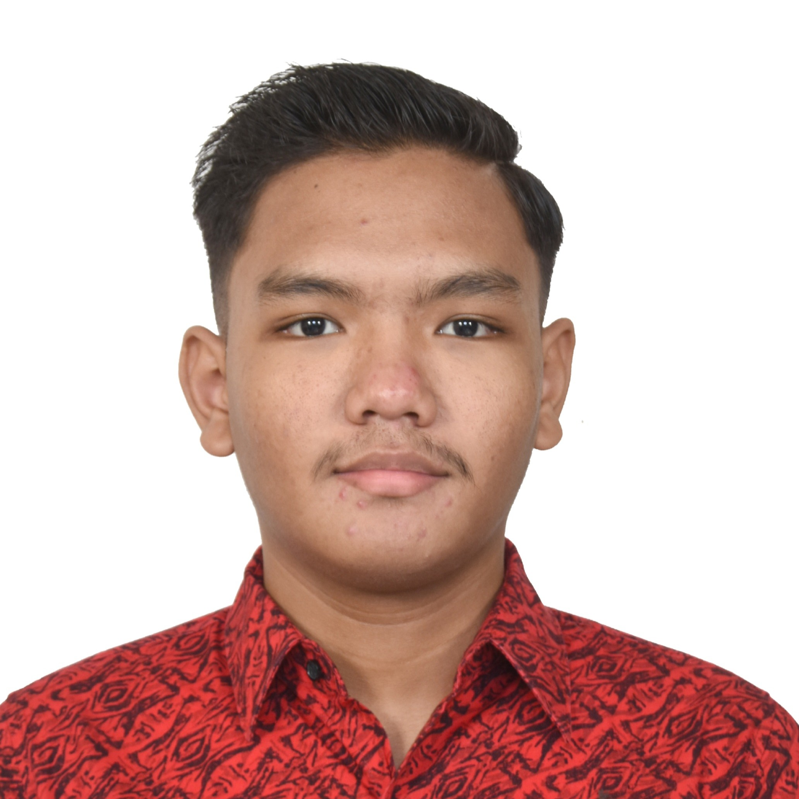

# Marchell Adi Pratama
> **Computer Science & Data Engineering Portfolio**  
> **Specialization**: Data Track (Data Science, Machine Learning & Intelligent Systems)  
> **Curriculum Structure**: 12 Trimesters (3 Semesters per Academic Year)  
> **Faculty**: Faculty of Information Technology, Universitas Kristen Satya Wacana (UKSW)  
> **Student ID (NIM)**: `672023081` | **GitHub**: [@MarchellProGit](https://github.com/MarchellProGit)

  

---

## Executive Summary

I am a Computer Science & Data Engineering student specializing in the **Data Track**, possessing cross-disciplinary technical mastery across **Data Science, Machine Learning, Deep Learning, Computer Vision, Software Engineering, Network Systems**, and **Web3 Blockchain Engineering**.

Operating within a 12-trimester academic system (3 semesters per academic year across a 4-year degree), my academic portfolio reflects both rigorous theoretical foundations and production-grade practical engineering across multiple technology verticals.

---

## Technical Competency Matrix

### 1. Data Science & Artificial Intelligence (Primary Focus)
* **Machine Learning**: Centroid K-Means, Density-Based DBSCAN, XGBoost Gradient Boosting, Random Forest Classifiers, Support Vector Machines (SVM), Logistic & Polynomial Regression, Naive Bayes.
* **Deep Learning & Neural Networks**: Convolutional Neural Networks (Conv2D/MaxPool2D), Recurrent Neural Networks (SimpleRNN), Stacked Long Short-Term Memory (LSTM) Networks, Fine-tuned Transfer Learning (MobileNetV2, ResNet50).
* **Computer Vision**: OpenCV Spatial Morphologies, YOLOv8 & YOLOv11 Real-Time Object Detection, Indonesian Sign Language (BISINDO) Gesture Recognition, 2D Fast Fourier Transform (FFT) Frequency Filtering.
* **Natural Language Processing**: Indonesian Sastrawi Stemming, Tokenization, TF-IDF Feature Extraction, Apify Web Scraping, Orange3 Visual Data Mining.
* **Methodologies & Frameworks**: CRISP-DM Framework, Stratified K-Fold Cross-Validation, Principal Component Analysis (PCA), Feature Engineering & Imputation.

### 2. Software & Systems Engineering
* **Languages**: C (`GCC` / `C99`), C++ (`STL`, `C++11`), Java (`JDK 17+`, `Swing`, `JDBC`, `MVC`), Python 3.10+, TypeScript, JavaScript, PHP 8, Solidity 0.8.20.
* **Architecture Patterns**: Model-View-Controller (MVC), Layered Microservices, Object-Oriented Programming (OOP), Component-Based UI Design.

### 3. Web Development & Web3 Ecosystem
* **Frontend**: React.js, Vite, TypeScript, TailwindCSS, HTML5, CSS3, Bootstrap 5.
* **Backend & APIs**: PHP 8, MySQL, Python (FastAPI, Streamlit), Node.js.
* **Blockchain Engineering**: Solidity Smart Contracts, Foundry Compilation (`forge`) & Anvil Local Testnet Deployment, Ethers.js / Viem, OpenZeppelin Governance Contracts (`NexusDAO`).

### 4. Network Engineering & Systems Programming
* **Networking**: Custom Python Multithreaded TCP Socket Server Engines, Socket Listeners, TCP/IP Communication, JSON Network Packet Serialization.

---

## Academic Record & Trimester Structure

| Academic Year | Trimester Period | Focus & Domain Coverage | Key Course Modules |
| :--- | :--- | :--- | :--- |
| **Year 1** | Trimester 1 - 3 | Low-Level Systems, C Programming & Web Foundations | Dasar-Dasar Pemrograman (DDP), Pengantar Teknologi Informasi (PTI) |
| **Year 2** | Trimester 4 - 6 | Data Structures, Algorithms & User Experience | Algoritma & Struktur Data (ASD), Interaksi Manusia & Komputer (IMK) |
| **Year 3** | Trimester 7 - 9 | Software Engineering, Java OOP, Full-Stack PHP & Networks | Kecerdasan Buatan (AI), Pemrograman Berorientasi Objek (PBO), Pemrograman Web (PW), Dasar Pemrograman Jaringan (DPJ) |
| **Year 4** | Trimester 10 - 12 | Advanced Data Track: ML, Deep Learning, Vision, Web3 & CRISP-DM | Machine Learning (ML), Analisis Data Eksploratif (EDA), Deep Learning (DL), Computer Vision (CVA), Teknik Optimalisasi (TO), Blockchain, Metodologi Data Science (MDS), NLP |

---

## Architectural & Codebase Standards

1. **Zero Junk Invariant**: Pure repository architecture free of temporary build artifacts, compiled object binaries (`.exe`, `.o`), virtual environments (`venv/`), raw document dumps (`.pdf`, `.docx`), and redundant files.
2. **Self-Documenting Standard**: All source files, modules, classes, and Jupyter Notebooks strictly follow self-documenting naming conventions based on domain responsibility.
3. **Strict Reproducibility**: Complete environment manifests provided (`requirements.txt`, `package.json`, `foundry.toml`).

---

## Verification & Author Metadata

* **Author**: Marchell Adi Pratama  
* **Student ID**: `672023081`  
* **GitHub Profile**: [MarchellProGit](https://github.com/MarchellProGit)  
* **Motto**: *SOLA DEI GLORIA*
