# 🎓 ChellAcademicHistory
> **Centralized Computer Science & Software Engineering Engineering Portfolio**  
> *Maintained by Marchell Adi Pratama*

[](https://python.org)
[](https://isocpp.org)
[](https://en.wikipedia.org/wiki/C_(programming_language))
[](https://oracle.com/java)
[](https://soliditylang.org)
[](https://pytorch.org)
[](https://tensorflow.org)
[](https://book.getfoundry.sh)
[](https://opensource.org/licenses/MIT)

---

## 📌 Executive Summary

**ChellAcademicHistory** is a production-grade, version-controlled repository containing source code, algorithms, machine learning pipelines, deep learning models, smart contracts, computer vision systems, and full-stack web applications developed across my academic curriculum. 

Every module in this repository adheres to strict engineering invariants:
* **Zero Junk Policy**: Free of temporary files, compiled binaries (`.exe`, `.o`), virtualenvs (`venv/`), raw document dumps (`.pdf`, `.docx`), and duplicate artifacts.
* **Self-Documenting Standard**: All code files, notebooks, and sub-systems are named strictly according to domain responsibility rather than student IDs or generic numbers.
* **Reproducible Execution**: Accompanied by exact dependency specifications (`requirements.txt`, `foundry.toml`, `package.json`).

---

## 🗺️ Academic Curriculum Architecture

```mermaid
flowchart TD
    subgraph S1["Semester 1: Systems & Web Foundations"]
        DDP["Dasar-Dasar Pemrograman (C99)"]
        PTI["Pengantar Teknologi Informasi (HTML5/CSS3/Bootstrap)"]
    end

    subgraph S2["Semester 2: Data Structures"]
        ASD["Algoritma & Struktur Data (C++11 STL)"]
    end

    subgraph S3["Semester 3: Human Computer Interaction"]
        IMK["Interaksi Manusia & Komputer (PayJek Web App)"]
    end

    subgraph S4["Semester 4: Software & Network Engineering"]
        AI["Kecerdasan Buatan (GA, EasyOCR, ID3)"]
        PBO["Pemrograman Berorientasi Objek (Java Swing MVC)"]
        PW["Pemrograman Web (PHP 8 / MySQL JobSeeker)"]
        DPJ["Dasar Pemrograman Jaringan (Python Sockets/TCP)"]
    end

    subgraph S6["Semester 6: Machine Intelligence"]
        ML["Machine Learning (K-Means, DBSCAN, Regression)"]
    end

    subgraph S7["Semester 7: Advanced Data Science & Vision"]
        EDA["Analisis Data Eksploratif (PCA, Seaborn)"]
        DL["Deep Learning (PyTorch/TensorFlow CNNs & RNNs)"]
        CVA["Computer Vision & Applications (YOLOv8/v11 BISINDO)"]
        TO["Teknik Optimalisasi (PSO & Harmony Search)"]
    end

    subgraph S9["Semester 9: Decentralized & Applied AI"]
        BC["Blockchain (Solidity, Foundry, NexusDAO dApp)"]
        MDS["Metodologi Data Science (XGBoost, Streamlit, FastAPI)"]
        NLP["Pemrosesan Bahasa Alami (Sastrawi, TF-IDF, Orange3)"]
    end

    S1 --> S2 --> S3 --> S4 --> S6 --> S7 --> S9
```



---

## 📂 Repository Directory Tree

```text
ChellAcademicHistory/
├── Semester-1/
│   ├── Dasar-Dasar-Pemrograman/        # C Programming (Matrix Engine, Geometry, Arrays)
│   └── Pengantar-Teknologi-Informasi/ # Responsive Web Architecture Capstone
├── Semester-2/
│   └── Algoritma-dan-Struktur-Data/    # C++ STL Data Structures (Vectors, Maps, Serialization)
├── Semester-3/
│   └── Interaksi-Manusia-dan-Komputer/ # UI/UX Design System & PayJek Web SuperApp
├── Semester-4/
│   ├── Kecerdasan-Buatan/              # AI Engines (Genetic Algo TSP, EasyOCR, ID3 Decision Trees)
│   ├── Pemrograman-Berorientasi-Objek/ # Java Swing GUI, JDBC & Inventory Management MVC
│   ├── Pemrograman-Web/                # Full-Stack PHP 8 / MySQL JobSeeker Web Portal
│   └── Dasar-Pemrograman-Jaringan/    # Python Sockets, TCP/IP Listener & Network Serialization
├── Semester-6/
│   └── Machine-Learning/               # Clustering (K-Means, DBSCAN), Regression & Classification
├── Semester-7/
│   ├── Analisis-Data-Eksploratif/      # EDA Pipelines, PCA & Visual Analytics
│   ├── Deep-Learning/                  # PyTorch / TensorFlow CNNs, RNNs & LSTM Time Series
│   ├── Computer-Vision-and-Applications/# OpenCV, YOLOv8/v11 BISINDO Sign Detection & Image Processing
│   └── Teknik-Optimalisasi/            # Particle Swarm Optimization (PSO) & Harmony Search
└── Semester-9/
    ├── Blockchain/                     # NexusDAO Solidity Smart Contracts, Foundry & React/Vite dApp
    ├── Metodologi-Data-Science/        # End-to-End CRISP-DM Machine Learning (XGBoost, Streamlit, FastAPI)
    └── Pemrosesan-Bahasa-Alami/        # NLP Pipelines, Sastrawi, TF-IDF & Orange3 Workflows
```

---

## 📌 Comprehensive Semester Breakdown

### 🔹 Semester 1: Low-Level Programming & Web Architecture
| Course Module | Primary Tech Stack | Key Architectural Implementations | Directory Link |
| :--- | :--- | :--- | :--- |
| **Dasar - Dasar Pemrograman (DDP)** | C (`GCC` / `C99`) | Dynamic Matrix Multipliers, 2D Geometry Engine, Pointer Manipulation, CLI Utilities | [`./Semester-1/Dasar-Dasar-Pemrograman/`](./Semester-1/Dasar-Dasar-Pemrograman/) |
| **Pengantar Teknologi Informasi (PTI)** | HTML5, CSS3, Bootstrap 5 | Semantic Web Layouts, Responsive Grids, Flexbox Styling & Web Portfolio Capstone | [`./Semester-1/Pengantar-Teknologi-Informasi/`](./Semester-1/Pengantar-Teknologi-Informasi/) |

### 🔹 Semester 2: Data Structures & Algorithms
| Course Module | Primary Tech Stack | Key Architectural Implementations | Directory Link |
| :--- | :--- | :--- | :--- |
| **Algoritma & Struktur Data (ASD)** | C++ (`STL`, `C++11`) | `std::vector`, `std::map`, Binary File Serialization, Academic Information System (SIA) Engine | [`./Semester-2/Algoritma-dan-Struktur-Data/`](./Semester-2/Algoritma-dan-Struktur-Data/) |

### 🔹 Semester 3: Human Computer Interaction
| Course Module | Primary Tech Stack | Key Architectural Implementations | Directory Link |
| :--- | :--- | :--- | :--- |
| **Interaksi Manusia & Komputer (IMK)** | HTML5, CSS3, JavaScript | PayJek On-Demand SuperApp & Food Delivery Responsive Frontend Prototype | [`./Semester-3/Interaksi-Manusia-dan-Komputer/`](./Semester-3/Interaksi-Manusia-dan-Komputer/) |

### 🔹 Semester 4: Core Software Engineering & Networking
| Course Module | Primary Tech Stack | Key Architectural Implementations | Directory Link |
| :--- | :--- | :--- | :--- |
| **Kecerdasan Buatan (AI)** | Python (`EasyOCR`, `GA`) | Genetic Algorithm Traveling Salesperson Problem (TSP) Solver, EasyOCR & ID3 Trees | [`./Semester-4/Kecerdasan-Buatan/`](./Semester-4/Kecerdasan-Buatan/) |
| **Pemrograman Berorientasi Objek (PBO)** | Java (`Swing`, `JDBC`, `MVC`) | Java Desktop MVC Architecture, Inventory Management & Warung Interface App | [`./Semester-4/Pemrograman-Berorientasi-Objek/`](./Semester-4/Pemrograman-Berorientasi-Objek/) |
| **Pemrograman Web (PW)** | PHP (`PHP 8`), MySQL, CSS3 | Full-Stack JobSeeker Web Portal, Admin/User Auth Sessions & Relational Schemas | [`./Semester-4/Pemrograman-Web/`](./Semester-4/Pemrograman-Web/) |
| **Dasar Pemrograman Jaringan (DPJ)** | Python (`Sockets`, `TCP/IP`) | Multithreaded TCP Socket Server Engine, Listener & JSON Network Serialization | [`./Semester-4/Dasar-Pemrograman-Jaringan/`](./Semester-4/Dasar-Pemrograman-Jaringan/) |

### 🔹 Semester 6: Machine Intelligence & Supervised Learning
| Course Module | Primary Tech Stack | Key Architectural Implementations | Directory Link |
| :--- | :--- | :--- | :--- |
| **Machine Learning (ML)** | Python (`scikit-learn`, `pandas`) | Centroid K-Means, Density-based DBSCAN, Logistic/Linear Regression & Decision Trees | [`./Semester-6/Machine-Learning/`](./Semester-6/Machine-Learning/) |

### 🔹 Semester 7: Advanced Data Analytics, Vision & Deep Learning
| Course Module | Primary Tech Stack | Key Architectural Implementations | Directory Link |
| :--- | :--- | :--- | :--- |
| **Analisis Data Eksploratif (EDA)** | Python (`seaborn`, `scikit-learn`) | Principal Component Analysis (PCA), Feature Profiling & Statistical Visualizations | [`./Semester-7/Analisis-Data-Eksploratif/`](./Semester-7/Analisis-Data-Eksploratif/) |
| **Deep Learning (DL)** | Python (`PyTorch`, `TensorFlow`) | Conv2D MNIST Networks, RNN Weather Forecasting & Multi-Layer LSTM Exchange Rate Models | [`./Semester-7/Deep-Learning/`](./Semester-7/Deep-Learning/) |
| **Computer Vision & Applications (CVA)** | Python (`OpenCV`, `YOLOv8/v11`) | BISINDO Sign Language Object Detection, FFT Frequency Filtering & Image Morphologies | [`./Semester-7/Computer-Vision-and-Applications/`](./Semester-7/Computer-Vision-and-Applications/) |
| **Teknik Optimalisasi (TO)** | Python (`scipy`, Metaheuristics) | Particle Swarm Optimization (PSO) Network Routing & Harmony Search Pitch Adjustment | [`./Semester-7/Teknik-Optimalisasi/`](./Semester-7/Teknik-Optimalisasi/) |

### 🔹 Semester 9: Web3 Systems & Applied Data Science
| Course Module | Primary Tech Stack | Key Architectural Implementations | Directory Link |
| :--- | :--- | :--- | :--- |
| **Blockchain Technology** | Solidity, Foundry, React, Vite | NexusDAO Decentralized Governance Contracts, Anvil Local Testnet & React dApp | [`./Semester-9/Blockchain/`](./Semester-9/Blockchain/) |
| **Metodologi Data Science (MDS)** | Python (`XGBoost`, `Streamlit`) | CRISP-DM End-to-End Predictive Weather System & FastAPI Microservices | [`./Semester-9/Metodologi-Data-Science/`](./Semester-9/Metodologi-Data-Science/) |
| **Pemrosesan Bahasa Alami (NLP)** | Python (`NLTK`, `Sastrawi`) | Twitter Sastrawi Stemming, BBC News TF-IDF Classifiers & Orange3 Visual Mining | [`./Semester-9/Pemrosesan-Bahasa-Alami/`](./Semester-9/Pemrosesan-Bahasa-Alami/) |

---

## 🛠️ Execution & Verification Quickstart

### 1. C & C++ Programs
```bash
# Compile C programs (GCC)
gcc -O2 -std=c99 Semester-1/Dasar-Dasar-Pemrograman/01-Praktikum/Main-Submissions/2D_Matrix_Operations.c -o matrix_app
./matrix_app

# Compile C++ programs (G++)
g++ -O2 -std=c++11 Semester-2/Algoritma-dan-Struktur-Data/01-Praktikum/Main-Submissions/Vector_Student_Grades_Manager.cpp -o grades_app
./grades_app
```

### 2. Java Swing Desktop Applications
```bash
cd Semester-4/Pemrograman-Berorientasi-Objek/03-Tugas-Rancang-Capstone/Inventory-Management-MVC
javac -d bin src/**/*.java
java -cp bin com.inventory.Main
```

### 3. Web Applications & Microservices
```bash
# PHP Web Portal
cd Semester-4/Pemrograman-Web/03-Tugas-Rancang-Capstone/JobSeeker-Web-Portal
php -S localhost:8000

# Streamlit Data Science Web App
cd Semester-9/Metodologi-Data-Science/anak-data-nih-bosh
streamlit run app.py
```

### 4. Blockchain & Smart Contracts (Foundry + React)
```bash
# Smart Contract Tests via Foundry
cd Semester-9/Blockchain/NexusDAO-Web3
forge build
forge test --summary

# Launch React + Vite Web3 Interface
cd app
npm install
npm run dev
```

---

## 📜 Author & License

* **Author**: Marchell Adi Pratama  
* **Institution**: Faculty of Information Technology, Universitas Kristen Satya Wacana (UKSW)  
* **GitHub**: [@MarchellProGit](https://github.com/MarchellProGit)  
* **License**: Open Academic Source (MIT License)  
* **Motto**: *SOLA DEI GLORIA* ✝️
