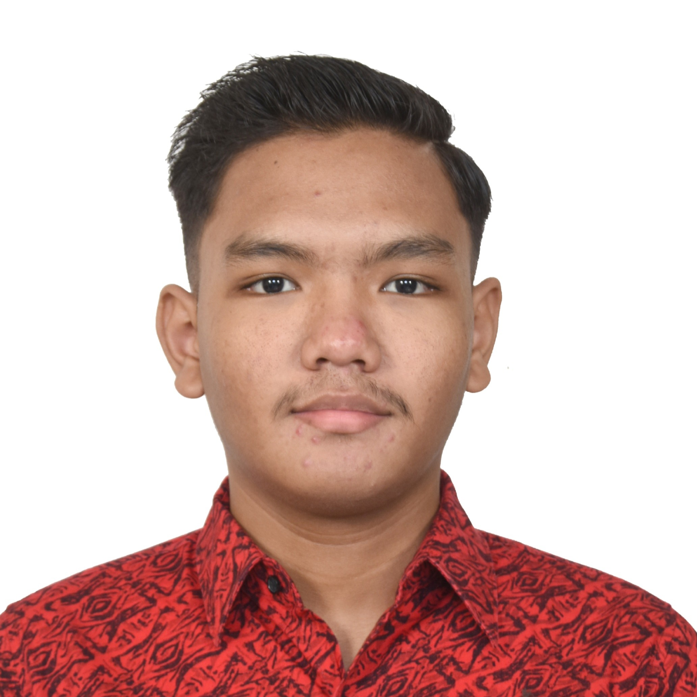
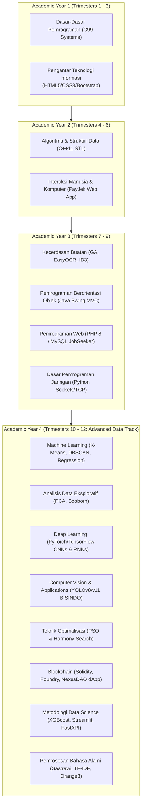

# ChellAcademicHistory
> **Centralized Computer Science & Data Engineering Portfolio**  
> **Author**: Marchell Adi Pratama ([Read Professional Profile](./ABOUT.md))  
> **Specialization**: Data Track (Data Science, Intelligent Systems & Full-Spectrum Computing)  
> **Curriculum**: 12 Trimesters (3 Semesters per Academic Year)

[](https://python.org)
[](https://isocpp.org)
[](https://en.wikipedia.org/wiki/C_(programming_language))
[](https://oracle.com/java)
[](https://soliditylang.org)
[](https://pytorch.org)
[](https://tensorflow.org)
[](https://book.getfoundry.sh)
[](https://opensource.org/licenses/MIT)

<p align="center">
  <br>
  <b>Marchell Adi Pratama</b><br>
  <i>Data Track Specialization | Computer Science & Software Engineering</i>
</p>

---

## Executive Summary

**ChellAcademicHistory** is a production-grade, version-controlled repository containing pure source code, algorithms, machine learning pipelines, deep learning models, smart contracts, computer vision systems, and full-stack web applications developed across a **12-trimester academic degree** (3 semesters per year across 4 academic years).

While specialized in the **Data Track** (Data Science, Machine Learning, Computer Vision, Deep Learning, and Predictive Analytics), this repository showcases multi-disciplinary engineering breadth spanning low-level C/C++ systems, Java desktop MVC software, PHP/MySQL web architecture, Python multithreaded networking, and Solidity Web3 smart contracts.

---

## Curriculum Architecture Map



---

## Repository Directory Tree

```text
ChellAcademicHistory/
├── assets/                             # Profile Media & System Diagrams
├── Semester-1/
│   ├── Dasar-Dasar-Pemrograman/        # C Programming (Matrix Engine, Geometry, Arrays)
│   └── Pengantar-Teknologi-Informasi/ # Responsive Web Architecture Capstone
├── Semester-2/
│   └── Algoritma-dan-Struktur-Data/    # C++ STL Data Structures (Vectors, Maps, Serialization)
├── Semester-3/
│   └── Interaksi-Manusia-dan-Komputer/ # UI/UX Design System & PayJek Web SuperApp
├── Semester-4/
│   ├── Kecerdasan-Buatan/              # AI Engines (Genetic Algo TSP, EasyOCR, ID3 Decision Trees)
│   ├── Pemrograman-Berorientasi-Objek/ # Java Swing GUI, JDBC & Inventory Management MVC
│   ├── Pemrograman-Web/                # Full-Stack PHP 8 / MySQL JobSeeker Web Portal
│   └── Dasar-Pemrograman-Jaringan/    # Python Sockets, TCP/IP Listener & Network Serialization
├── Semester-6/
│   └── Machine-Learning/               # Clustering (K-Means, DBSCAN), Regression & Classification
├── Semester-7/
│   ├── Analisis-Data-Eksploratif/      # EDA Pipelines, PCA & Visual Analytics
│   ├── Deep-Learning/                  # PyTorch / TensorFlow CNNs, RNNs & LSTM Time Series
│   ├── Computer-Vision-and-Applications/# OpenCV, YOLOv8/v11 BISINDO Sign Detection & Image Processing
│   └── Teknik-Optimalisasi/            # Particle Swarm Optimization (PSO) & Harmony Search
└── Semester-9/
    ├── Blockchain/                     # NexusDAO Solidity Smart Contracts, Foundry & React/Vite dApp
    ├── Metodologi-Data-Science/        # End-to-End CRISP-DM Machine Learning (XGBoost, Streamlit, FastAPI)
    └── Pemrosesan-Bahasa-Alami/        # NLP Pipelines, Sastrawi, TF-IDF & Orange3 Workflows
```

---

## Coursework Breakdown by Trimester & Technical Domain

### 1. Low-Level Systems & Web Architecture (Trimesters 1 - 3)
| Module Title | Primary Tech Stack | Architectural Implementations | Directory Link |
| :--- | :--- | :--- | :--- |
| **Dasar - Dasar Pemrograman (DDP)** | C (`GCC` / `C99`) | Matrix Multipliers, 2D Geometry Engine, Dynamic Arrays, CLI Tools | [`./Semester-1/Dasar-Dasar-Pemrograman/`](./Semester-1/Dasar-Dasar-Pemrograman/) |
| **Pengantar Teknologi Informasi (PTI)** | HTML5, CSS3, Bootstrap 5 | Responsive Layouts, Flexbox Grids, Semantic Web Architecture | [`./Semester-1/Pengantar-Teknologi-Informasi/`](./Semester-1/Pengantar-Teknologi-Informasi/) |
| **Algoritma & Struktur Data (ASD)** | C++ (`STL`, `C++11`) | Vectors, Maps, Binary File Serialization, Academic Information System (SIA) Engine | [`./Semester-2/Algoritma-dan-Struktur-Data/`](./Semester-2/Algoritma-dan-Struktur-Data/) |
| **Interaksi Manusia & Komputer (IMK)** | HTML5, CSS3, JavaScript | PayJek On-Demand SuperApp & Food Delivery Responsive UI Prototype | [`./Semester-3/Interaksi-Manusia-dan-Komputer/`](./Semester-3/Interaksi-Manusia-dan-Komputer/) |

### 2. Software Engineering & Networking (Trimesters 4 - 6)
| Module Title | Primary Tech Stack | Architectural Implementations | Directory Link |
| :--- | :--- | :--- | :--- |
| **Kecerdasan Buatan (AI)** | Python (`EasyOCR`, `GA`) | Genetic Algorithm TSP Solver, EasyOCR & ID3 Decision Trees | [`./Semester-4/Kecerdasan-Buatan/`](./Semester-4/Kecerdasan-Buatan/) |
| **Pemrograman Berorientasi Objek (PBO)** | Java (`Swing`, `JDBC`, `MVC`) | Java Desktop MVC Architecture, Inventory Management App | [`./Semester-4/Pemrograman-Berorientasi-Objek/`](./Semester-4/Pemrograman-Berorientasi-Objek/) |
| **Pemrograman Web (PW)** | PHP (`PHP 8`), MySQL | Full-Stack JobSeeker Web Portal, Admin/User Auth Sessions | [`./Semester-4/Pemrograman-Web/`](./Semester-4/Pemrograman-Web/) |
| **Dasar Pemrograman Jaringan (DPJ)** | Python (`Sockets`, `TCP/IP`) | Multithreaded TCP Socket Server Engine & JSON Network Packet Serialization | [`./Semester-4/Dasar-Pemrograman-Jaringan/`](./Semester-4/Dasar-Pemrograman-Jaringan/) |

### 3. Advanced Data Track & Web3 Systems (Trimesters 7 - 12)
| Module Title | Primary Tech Stack | Architectural Implementations | Directory Link |
| :--- | :--- | :--- | :--- |
| **Machine Learning (ML)** | Python (`scikit-learn`, `pandas`) | K-Means Centroids, Density DBSCAN, Logistic/Linear Regression | [`./Semester-6/Machine-Learning/`](./Semester-6/Machine-Learning/) |
| **Analisis Data Eksploratif (EDA)** | Python (`seaborn`, `scikit-learn`) | Principal Component Analysis (PCA), Feature Imputation & Correlation Matrices | [`./Semester-7/Analisis-Data-Eksploratif/`](./Semester-7/Analisis-Data-Eksploratif/) |
| **Deep Learning (DL)** | Python (`PyTorch`, `TensorFlow`) | Conv2D MNIST Classifier, RNN Weather Model, Multi-Layer LSTM Exchange Rate Model | [`./Semester-7/Deep-Learning/`](./Semester-7/Deep-Learning/) |
| **Computer Vision & Applications (CVA)** | Python (`OpenCV`, `YOLOv8/v11`) | BISINDO Sign Language Object Detection, 2D FFT Frequency Filtering | [`./Semester-7/Computer-Vision-and-Applications/`](./Semester-7/Computer-Vision-and-Applications/) |
| **Teknik Optimalisasi (TO)** | Python (`scipy`, Metaheuristics) | Particle Swarm Optimization (PSO) Network Routing & Harmony Search | [`./Semester-7/Teknik-Optimalisasi/`](./Semester-7/Teknik-Optimalisasi/) |
| **Blockchain Technology** | Solidity, Foundry, React, Vite | NexusDAO Decentralized Governance Contracts, Anvil Local Testnet & React dApp | [`./Semester-9/Blockchain/`](./Semester-9/Blockchain/) |
| **Metodologi Data Science (MDS)** | Python (`XGBoost`, `Streamlit`) | CRISP-DM Predictive Weather System & FastAPI Microservices | [`./Semester-9/Metodologi-Data-Science/`](./Semester-9/Metodologi-Data-Science/) |
| **Pemrosesan Bahasa Alami (NLP)** | Python (`NLTK`, `Sastrawi`) | Twitter Sastrawi Stemming, BBC News TF-IDF Classifiers & Orange3 Visual Mining | [`./Semester-9/Pemrosesan-Bahasa-Alami/`](./Semester-9/Pemrosesan-Bahasa-Alami/) |

---

## Execution & Verification Quickstart

### 1. Systems & Low-Level Binaries (C / C++)
```bash
# Compile C Systems Module (GCC)
gcc -O2 -std=c99 Semester-1/Dasar-Dasar-Pemrograman/01-Praktikum/Main-Submissions/2D_Matrix_Operations.c -o matrix_app
./matrix_app

# Compile C++ Module (G++)
g++ -O2 -std=c++11 Semester-2/Algoritma-dan-Struktur-Data/01-Praktikum/Main-Submissions/Vector_Student_Grades_Manager.cpp -o grades_app
./grades_app
```

### 2. Java Swing Desktop Applications
```bash
cd Semester-4/Pemrograman-Berorientasi-Objek/03-Tugas-Rancang-Capstone/Inventory-Management-MVC
javac -d bin src/**/*.java
java -cp bin com.inventory.Main
```

### 3. Data Science & Machine Learning Web Applications
```bash
# Streamlit Data Science Web App
cd Semester-9/Metodologi-Data-Science/anak-data-nih-bosh
pip install -r requirements.txt
streamlit run app.py
```

### 4. Smart Contracts & Web3 dApps (Foundry + React)
```bash
# Smart Contract Tests via Foundry
cd Semester-9/Blockchain/NexusDAO-Web3
forge build
forge test --summary

# Launch React + Vite Web3 Interface
cd app
npm install
npm run dev
```

---

## Author & License

* **Author**: Marchell Adi Pratama ([Read Professional Profile](./ABOUT.md))  
* **Faculty**: Faculty of Information Technology, Universitas Kristen Satya Wacana (UKSW)  
* **GitHub**: [@MarchellProGit](https://github.com/MarchellProGit)  
* **License**: Open Academic Source (MIT License)  
* **Motto**: *SOLA DEI GLORIA*
