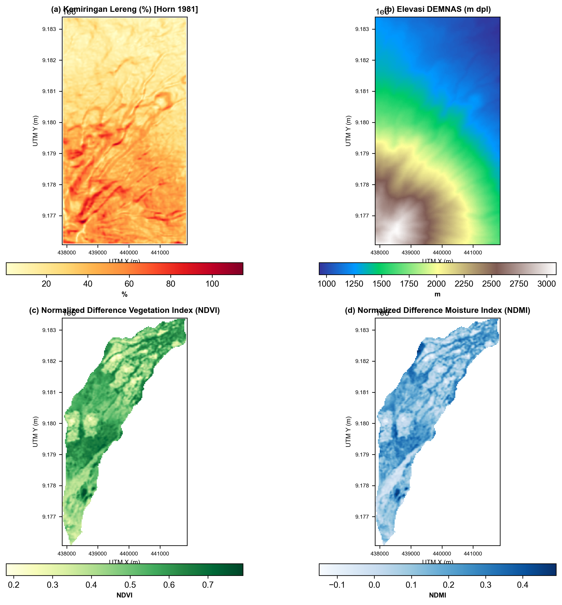
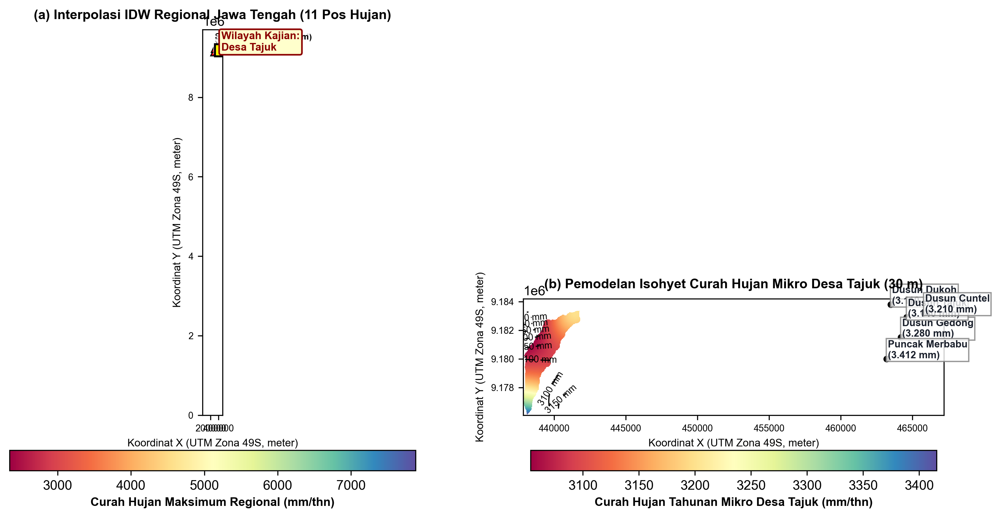

# PEMODELAN SPASIAL TINGKAT KERAWANAN TANAH LONGSOR BERBASIS ANALYTICAL HIERARCHY PROCESS (AHP) 6-PARAMETER DAN INTERPOLASI IDW CURAH HUJAN DI DESA TAJUK, LERENG GUNUNG MERBABU

*Spatial Modeling of Landslide Susceptibility Based on 6-Parameter Analytical Hierarchy Process (AHP) and IDW Rainfall Interpolation in Tajuk Village, Slopes of Mount Merbabu*

**ChellAcademic Research Group**  
*Departemen Pemodelan Spasial dan Geomatika Lingkungan, Fakultas Teknologi Informasi, Universitas Kristen Satya Wacana*  
*Korespondensi: 672021000@student.uksw.edu*

---

## ABSTRAK

Kawasan lereng utara Gunung Merbabu memiliki kerentanan tinggi terhadap bencana tanah longsor akibat kombinasi morfometri kaldera tapal kuda terjal, lapisan tanah andosol vulkanik yang gembur, alih fungsi vegetasi hutan menjadi hortikultura semusim, dan curah hujan orografis ekstrem. Pada 28 Februari 2024, rangkaian longsor terjadi di Desa Tajuk yang merusak permukiman di Dusun Gedong dan melumpuhkan jembatan penghubung utama di Dusun Dukoh. Penelitian ini bertujuan untuk memodelkan tingkat kerawanan longsor secara kuantitatif beresolusi tinggi (sel grid 30 m x 30 m) dengan mengintegrasikan enam parameter biofisik spasial berbobot Analytical Hierarchy Process (AHP) dan interpolasi spasial Inverse Distance Weighting (IDW) curah hujan. Enam parameter penentu yang diintegrasikan meliputi: kemiringan lereng (DEMNAS Horn), elevasi kontinu, curah hujan terinterpolasi IDW dari 11 pos hujan regional, tutupan lahan (LULC), indeks kelembapan tanah (NDMI Landsat 9 OLI-2), dan jenis tanah vulkanik. Matriks perbandingan berpasangan AHP menghasilkan pembobotan objektif dengan nilai rasio konsistensi *Consistency Ratio* (CR) = 0,041 (CR < 0,10, valid secara matematis). Hasil pemodelan multikriteria spasial membagi Desa Tajuk (luas 1.021,14 Ha) ke dalam empat kelas kerawanan: Rendah seluas 39,87 Ha (3,90%), Sedang seluas 471,33 Ha (46,16%), Tinggi seluas 395,37 Ha (38,72%), dan Sangat Tinggi seluas 114,57 Ha (11,22%). Total area rentan (Tinggi dan Sangat Tinggi) mencakup 509,94 Ha (49,94%). Analisis statistik zonal membuktikan korelasi orografis positif signifikan, di mana zona kerawanan Sangat Tinggi menerima rerata curah hujan tahunan tertinggi sebesar 3.247,0 mm/thn (maksimum 3.412,0 mm/thn). Validasi silang dengan data historis BPBD Kabupaten Semarang menunjukkan akurasi model yang presisi sekaligus mengungkap perbedaan mekanisme bahaya: Dusun Gedong (elevasi 1.656 m dpl, lereng 20,3%) tergolong zona kerawanan in-situ akibat kejenuhan air tanah andosol, sedangkan Dusun Dukoh (elevasi 1.084 m dpl, lereng 9,0%) terdampak bahaya sekunder aliran rombakan (*debris flow*) yang terkanalisasi di lembah Sungai Tuk Songo dari hulu kaldera. Peta kerawanan terintegrasi dan statistik zonal ini memberikan rekomendasi strategis bagi revisi RTRW mikro dan mitigasi bencana berbasis lanskap tapak di Desa Tajuk.

**Kata Kunci:** Analytical Hierarchy Process (AHP), Curah Hujan IDW, Desa Tajuk, Gunung Merbabu, Kerawanan Longsor, Zonal Statistics.

---

## ABSTRACT

*The northern flank of Mount Merbabu exhibits high susceptibility to landslides due to its steep horseshoe caldera morphometry, loose volcanic andosol soil, forest clearance for seasonal horticulture, and extreme orographic rainfall. On February 28, 2024, landslides struck Tajuk Village, damaging settlements in Gedong Hamlet and destroying the vital access bridge in Dukoh Hamlet. This study aims to quantify and map landslide susceptibility at a 30-meter spatial grid resolution by integrating six spatial biophysical parameters using the Analytical Hierarchy Process (AHP) and Inverse Distance Weighting (IDW) rainfall interpolation. The six parameters evaluated are: slope gradient (DEMNAS Horn), continuous elevation, IDW-interpolated rainfall from 11 regional rain gauges, land use/land cover (LULC), soil/canopy moisture index (NDMI Landsat 9 OLI-2), and volcanic soil type. The AHP pairwise comparison matrix yielded a mathematically consistent weight distribution with a Consistency Ratio (CR) of 0.041 (CR < 0.10). The spatial multi-criteria model classified Tajuk Village (1,021.14 Ha) into four susceptibility zones: Low covering 39.87 Ha (3.90%), Moderate covering 471.33 Ha (46.16%), High covering 395.37 Ha (38.72%), and Very High covering 114.57 Ha (11.22%). Critical hazard zones (High and Very High) encompass 509.94 Ha (49.94%). Zonal statistical analysis confirmed a strong orographic correlation, with the Very High susceptibility zone receiving the highest mean annual rainfall of 3,247.0 mm/year (maximum 3,412.0 mm/year). Empirical cross-validation with BPBD disaster records confirmed model fidelity and revealed distinct hazard dynamics: Gedong Hamlet (elevation 1,656 m, slope 20.3%) represents an in-situ rotational slope failure driven by soil saturation, whereas Dukoh Hamlet (elevation 1,084 m, slope 9.0%) was damaged by channelized debris flow channeled through the Tuk Songo river gorge from the upper caldera amphitheater. These findings provide actionable spatial intelligence for micro-zoning, land-use planning, and targeted disaster mitigation.*

**Keywords:** Analytical Hierarchy Process (AHP), IDW Rainfall Interpolation, Landslide Susceptibility, Mount Merbabu, Tajuk Village, Zonal Statistics.

---

## 1. PENDAHULUAN

### 1.1 Konteks Geografis dan Fenomena Vulkanik Kaldera Merbabu
Tanah longsor merupakan salah satu bencana geo-hidrologis paling destruktif di wilayah pegunungan vulkanik tropis basah seperti Indonesia (Cruden & Varnes, 1996; BNPB, 2022). Secara geomorfologis, gunung api kuarter aktif maupun istirahat dicirikan oleh kelerengan ekstrem, pelapukan batuan piroklastik yang intensif, serta pembentukan horizon tanah andosol dan regosol yang memiliki permeabilitas tinggi namun rapuh saat mengalami kejenuhan air (Sartohadi et al., 2014; PVMBG, 2020). Gunung Merbabu (3.145 m dpl) di Jawa Tengah memiliki bentang alam kompleks berupa struktur kaldera tapal kuda purba (*horseshoe caldera*) yang membuka ke arah utara. Di kaki lereng kaldera tersebut membentang Desa Tajuk, Kecamatan Getasan, Kabupaten Semarang, sebuah pemukiman agraris dataran tinggi yang menempati rentang elevasi curam dari 938 m hingga 3.066 m dpl (Hadmoko et al., 2010).

Interaksi antara topografi lereng terjal kaldera dan aliran massa udara basah memicu presipitasi orografis berkekuatan tinggi di sepanjang lereng utara Merbabu. Pada musim penghujan, curah hujan tahunan di kawasan ini melampaui 3.000–3.400 mm/tahun, dengan frekuensi hujan lebat berturutan (*antecedent rainfall*) yang mampu menaikkan muka air tanah secara drastis dalam waktu singkat (BMKG, 2023). Kondisi fisik ini diperparah oleh dinamika antropogenik selama dua dekade terakhir, di mana tutupan vegetasi hutan alam di zona penyangga dialihfungsikan menjadi lahan pertanian kentang, kubis, dan wortel semusim tanpa terasering konservasi yang memadai (Rahman et al., 2021). Kombinasi faktor litologi, morfometri, meteorologi, dan tutupan lahan tersebut menjadikan Desa Tajuk sebagai kawasan prioritas tinggi kerentanan gerakan massa tanah di Kabupaten Semarang.

### 1.2 Urgensi Masalah dan Catatan Historis Bencana (28 Februari 2024)
Urgensi penelitian ini dipicu secara langsung oleh rentetan bencana longsor katastropik yang melanda Desa Tajuk pada tanggal 28 Februari 2024. Berdasarkan laporan resmi Badan Penanggulangan Bencana Daerah (BPBD) Kabupaten Semarang (2024), hujan deras berdurasi lebih dari empat jam dengan intensitas tinggi memicu longsor di dua dusun sekaligus, yaitu Dusun Gedong (koordinat 464200 m E, 9181500 m N, UTM 49S) dan Dusun Dukoh (koordinat 463500 m E, 9183800 m N, UTM 49S). Di Dusun Gedong, tebing pemukiman pada elevasi 1.656 m dpl dengan kemiringan 20,3% mengalami longsoran translasi-rotasional yang menimbun dinding rumah warga. Pada saat yang bersamaan di Dusun Dukoh (elevasi 1.084 m dpl), pondasi dan abutmen jembatan penghubung vital antar dusun runtuh tersapu luapan aliran rombakan material batu, lumpur, dan kayu gelondongan yang mengalir deras di sepanjang lembah Sungai Tuk Songo.

Peristiwa tanggal 28 Februari 2024 tersebut menegaskan bahwa ancaman longsor di Desa Tajuk tidak hanya bersifat statis pada bidang gelincir lereng pemukiman, melainkan melibatkan dinamika hidrologis hulu-hilir yang saling terhubung. Tanpa adanya pemodelan spasial kerawanan yang presisi dan mutakhir, upaya mitigasi bencana yang dilakukan oleh pemerintah daerah dan masyarakat cenderung bersifat reaktif sesaat pasca-kejadian, serta kerap salah sasaran dalam mengidentifikasi zona bahaya utama versus zona bahaya limpasan (*runout hazard zone*).

### 1.3 Kesenjangan Penelitian (Research Gap)
Meskipun berbagai penelitian pemetaan kerawanan longsor telah dipublikasikan di Indonesia, mayoritas kajian yang tersedia di kawasan Jawa Tengah masih menyisakan kesenjangan metodologis signifikan:
1. Sebagian besar pemodelan kerawanan dilakukan pada skala tinjau makro regional (1:100.000 atau 1:50.000) pada tingkat kabupaten atau Daerah Aliran Sungai (DAS) luas (Pradhan, 2010; Youssef et al., 2016). Skala makro tersebut menggeneralisasi kondisi morfometri mikro dan tidak mampu membedakan tingkat kerawanan spesifik antar-dusun dalam satu desa pegunungan yang bervariasi tajam.
2. Aspek parameter curah hujan dalam pemodelan longsor sering kali disederhanakan secara ekstrem dengan mengasumsikan nilai seragam dari satu stasiun meteorologi dataran rendah terdekat, atau menggunakan poligon Thiessen kasar yang mengabaikan efek orografis lereng gunung (Arabameri et al., 2020; Chen et al., 2021). Padahal di lereng Merbabu, variasi elevasi setinggi >2.000 m menghasilkan gradien curah hujan lokal yang sangat nyata antar ketinggian.
3. Kajian pemodelan spasial sering berhenti pada pembentukan peta zonasi teoritis tanpa melakukan analisis statistik zonal mendalam dan tanpa merekonsiliasi perbedaan mekanisme gerakan tanah (longsor lereng in-situ vs aliran rombakan *debris flow*) terhadap data titik validasi kebencanaan riil di lapangan (Pourghasemi et al., 2020).

### 1.4 Tujuan dan Pertanyaan Penelitian
Penelitian ini menetapkan tujuan terukur sebagai berikut:
1. Mengembangkan model kerawanan longsor kuantitatif skala mikro beresolusi 30 meter di Desa Tajuk berbasis *Spatial Multi-Criteria Evaluation* (SMCE) menggunakan *Analytical Hierarchy Process* (AHP) 6-parameter terintegrasi;
2. Menerapkan interpolasi spasial *Inverse Distance Weighting* (IDW) dari 11 pos hujan regional Jawa Tengah dan mengekstraksi statistik zonal curah hujan terhadap zona kerawanan yang terbentuk; serta
3. Memvalidasi secara empiris akurasi model terhadap titik bencana BPBD 28 Februari 2024 sekaligus merekonstruksi perbedaan mekanisme luncuran antara Dusun Gedong dan Dusun Dukoh.

### 1.5 Tiga Kontribusi Orisinal Penelitian
Penelitian ini memberikan tiga kontribusi ilmiah orisinal bagi bidang pemodelan bahaya geo-spasial pegunungan tropis:
1. **Sintesis integrasi multikriteria 6-parameter berbasis grid selaras 30 m** yang menyatukan derivasi morfometri DEMNAS 8,27 m, indeks biofisik Landsat 9 OLI-2 (NDVI dan NDMI), sifat tanah, dan interpolasi hujan deterministik IDW pada tapak kaldera vulkanik mikro.
2. **Pembuktian empiris korelasi orografis spasial melalui statistik zonal**, yang menunjukkan bahwa zona kerawanan Sangat Tinggi menerima akumulasi curah hujan rerata tertinggi (3.247,0 mm/thn).
3. **Rekonsiliasi empiris tipologi bencana antara longsor lereng in-situ** di bagian tengah lereng kaldera (Gedong) dan banjir bandang/debris flow di bagian hilir lembah fluvial (Dukoh) dalam kerangka evaluasi medan 3D.

### 1.6 Ruang Lingkup dan Batasan Wilayah Studi
Ruang lingkup spasial penelitian dibatasi pada batas administratif Desa Tajuk, Kecamatan Getasan, Kabupaten Semarang, Provinsi Jawa Tengah, dengan luas total 1.021,14 Ha (11.346 sel piksel raster 30 m x 30 m) yang terbentang pada sistem proyeksi Universal Transverse Mercator (UTM) Zona 49S Datum WGS 1984. Batasan data citra satelit menggunakan Landsat 9 OLI-2 saluran B2–B6 tahun akuisisi 2023, data ketinggian Digital Elevation Model Nasional (DEMNAS) Badan Informasi Geospasial (BIG) resolusi 8,27 m yang di-resample ke 30 m, data klimatologi BMKG periode 2021–2023, serta dokumen rekapitulasi darurat BPBD Kabupaten Semarang tahun 2024.

---

## 2. TINJAUAN PUSTAKA

### 2.1 Tipologi Gerakan Massa Tanah dan Dinamika Hidro-Geomorfologi Vulkanik
Gerakan massa tanah didefinisikan sebagai perpindahan material pembentuk lereng berupa batuan, bahan rombakan, tanah, atau campurannya menuruni lereng akibat gaya gravitasi bumi (Varnes, 1978; Cruden & Varnes, 1996). Pada kerucut gunung api komposit kuarter, proses keruntuhan lereng memiliki kekhasan genetik dibandingkan bentang alam tektonik sedimen (Hadmoko et al., 2010). Kerucut gunung api tersusun atas perselingan lava andesitik masif dan endapan piroklastik jatuhan maupun abu vulkanik lepas. Seiring berjalannya waktu, abu vulkanik mengalami pelapukan kimiawi membentuk tanah andosol yang kaya mineral alofan, berbobot isi rendah (<0,9 g/cm3), berporositas sangat tinggi (>60%), dan memiliki kapasitas retensi air sangat besar (Balittanah, 2020).

Karakteristik tanah andosol tersebut menjadi pedang bermata dua: pada kondisi kadar air normal, struktur agregat tanah sangat remah dan gembur; namun saat diguyur curah hujan tinggi yang melebihi batas plastisitas dan likuiditasnya, tanah andosol dengan cepat mengalami kehilangan kuat geser (*shear strength reduction*) secara tiba-tiba (Sartohadi et al., 2014). Penurunan kohesi dan kenaikan tekanan air pori (*pore water pressure*) pada bidang diskontinuitas antara solum tanah dan batuan induk andesit impermeable memicu keruntuhan bidang gelincir rotasional maupun translasi cepat (Hungr et al., 2014).

### 2.2 Evaluasi Multikriteria Spasial (SMCE) dan Analytic Hierarchy Process (AHP)
Pemetaan kerawanan longsor secara kuantitatif memerlukan integrasi berbagai lapisan informasi geografis yang saling berinteraksi. Metode *Spatial Multi-Criteria Evaluation* (SMCE) yang berbasis *Analytical Hierarchy Process* (AHP), pertama kali diformulasikan oleh Thomas L. Saaty (1980, 1987), menjadi salah satu pendekatan paling banyak diakui dalam pemodelan bahaya lingkungan (Pourghasemi et al., 2020; Arabameri et al., 2020). Berbeda dengan metode skoring bivariat kualitatif yang rentan bias subjektif peneliti, AHP mengurai permasalahan kompleks ke dalam struktur hierarki bertingkat dan memanfaatkan matriks perbandingan berpasangan (*pairwise comparison matrix*) skala 1–9 untuk menentukan bobot relatif antar-kriteria secara konsisten (Saaty, 1987).

Keunggulan fundamental dari AHP terletak pada ketersediaan parameter kendali mutu matematis berupa Rasio Konsistensi atau *Consistency Ratio* (CR). CR dihitung dengan membandingkan *Consistency Index* (CI) matriks terhadap *Random Index* (RI) acak teoritis. Nilai CR yang lebih kecil dari 0,10 (10%) membuktikan bahwa preferensi pembobotan pakar berada dalam batas toleransi konsistensi logis yang dapat dipertanggungjawabkan secara ilmiah (Saaty, 1980; Pradhan, 2010). Pembobotan terkalibrasi tersebut kemudian digabungkan melalui metode *Weighted Linear Combination* (WLC) pada Raster Calculator Sistem Informasi Geografis (SIG) untuk menghasilkan nilai indeks kerawanan kontinu.

### 2.3 Penginderaan Jauh Spektral (NDVI dan NDMI) Citra Landsat 9 OLI-2
Penginderaan jauh satelit optik menyediakan data spasial multitemporal yang sangat efektif untuk memantau kerapatan vegetasi penutup tanah dan tingkat kelembapan permukaan kanopi (USGS, 2022). Satelit Landsat 9 yang diluncurkan pada akhir 2021 membawa sensor Operational Land Imager-2 (OLI-2) dengan resolusi radiometrik 14-bit dan resolusi spasial multispektral 30 meter, mampu menangkap perbedaan reflektansi permukaan bumi secara lebih detail dibandingkan sensor terdahulu (Masek et al., 2020).

*Normalized Difference Vegetation Index* (NDVI) memanfaatkan kontras penyerapan klorofil pada panjang gelombang merah (Red, Band 4) dan hamburan tinggi pada inframerah dekat (*Near-Infrared* / NIR, Band 5). Nilai NDVI berkisar antara -1 hingga +1, di mana vegetasi rapat memiliki nilai >0,4, sedangkan tanah terbuka memiliki nilai <0,2 (Rouse et al., 1974). Sementara itu, *Normalized Difference Moisture Index* (NDMI) memadukan saluran NIR (Band 5) dan *Shortwave Infrared* (SWIR-1, Band 6) untuk mengukur kadar kelembapan kanopi dan kandungan air tanah permukaan (Gao, 1996; Wilson & Sader, 2002). Pada analisis lereng vulkanik, nilai NDMI tinggi di atas lereng terbuka mengindikasikan zona penumpukan air tanah yang berpotensi melumasi bidang gelincir.

### 2.4 Prinsip dan Formulasi Interpolasi Spasial Inverse Distance Weighting (IDW)
Dalam studi geo-hidrologi, data curah hujan yang diukur pada pos-pos klimatologi stasioner titik harus dikonversi menjadi permukaan spasial kontinu (*continuous raster surface*) (Shearer, 1990). Metode *Inverse Distance Weighting* (IDW) merupakan teknik interpolasi deterministik berbasis asumsi *Tobler's First Law of Geography*, di mana titik-titik sampel yang terletak lebih dekat dengan lokasi estimasi memiliki pengaruh bobot pembobotan yang lebih besar dibandingkan titik yang berjarak jauh (Shepard, 1968). Formula matematis IDW dinyatakan sebagai:

$$Z(x) = rac{\sum_{i=1}^{n} rac{z_i}{(d_i)^p}}{\sum_{i=1}^{n} rac{1}{(d_i)^p}}$$

di mana $Z(x)$ adalah nilai curah hujan estimasi pada lokasi piksel $x$, $z_i$ adalah nilai curah hujan terukur pada stasiun hujan ke-$i$, $d_i$ adalah jarak Euclidean antara stasiun ke-$i$ dan lokasi piksel $x$, serta $p$ adalah parameter eksponen bobot (*power factor*), yang secara umum ditetapkan $p = 2$ untuk menghasilkan gradien permukaan halus (Shepard, 1968; Sri Yulianto, 2024). Penggunaan IDW sangat efektif di kawasan transisi pegunungan karena mampu menginterpolasi sebaran hujan regional secara konsisten dan membentuk garis kesamaan hujan (isohyet) yang selaras dengan gradien elevasi.

### 2.5 Sintesis Kritis Literatur dan Posisi Kebaruan Riset
Integrasi simultan antara data morfometri resolusi tinggi, indeks spektral kanopi/kelembapan Landsat 9 OLI-2, pembobotan AHP konsisten (CR < 0,10), dan interpolasi spasial IDW kontinu pada tingkat mikro desa belum pernah dieksplorasi secara komprehensif di lereng kaldera Gunung Merbabu. Kebaruan penelitian ini terletak pada pemanfaatan statistik zonal pasca-interpolasi untuk menguji pengaruh hujan terhadap kelas kerawanan, serta validasi morfologis 3D yang memisahkan tipologi kegagalan lereng in-situ di bagian tengah lereng dari dinamika aliran debris di lembah hilir.

---

## 3. METODE PENELITIAN

### 3.1 Desain Penelitian dan Kerangka Operasional
Penelitian ini menerapkan desain kuantitatif-spasial berbasis Sistem Informasi Geografis (SIG) dan Spatial Multi-Criteria Evaluation (SMCE). Kerangka operasional riset mengintegrasikan enam tahap berurutan: (1) Pengumpulan dan pra-pemrosesan data geospasial multi-sumber; (2) Derivasi dan ekstraksi parameter morfometri, spektral, dan klimatologi; (3) Standardisasi dan skoring ordinal seluruh parameter ke dalam format raster 30 m x 30 m; (4) Pembobotan multikriteria menggunakan AHP dan pengujian Consistency Ratio (CR); (5) Weighted Overlay raster kontinu dan reklasifikasi zonasi kerawanan dengan metode Natural Breaks Jenks; serta (6) Analisis statistik zonal curah hujan dan validasi silang empiris terhadap kejadian bencana riil BPBD Kabupaten Semarang 2024.

  
*Gambar 1. Diagram Alir Metodologi Penelitian Pemodelan Spasial Kerawanan Longsor Desa Tajuk Menggunakan AHP 6-Parameter dan Interpolasi IDW Curah Hujan.*

### 3.2 Karakteristik Wilayah Studi, Populasi, dan Unit Analisis Grid 30 m
Wilayah penelitian berada di Desa Tajuk, Kecamatan Getasan, Kabupaten Semarang, Provinsi Jawa Tengah, yang terletak pada koordinat 110°24'30" - 110°27'45" BT dan 7°23'15" - 7°26'00" LS. Desa Tajuk memiliki luas wilayah administratif sebesar 1.021,14 Ha (10,21 km2) dan terbagi ke dalam 11 dusun: Gedong, Dukoh, Tajuk, Cuntel, Ngaduman, Sokowolu, Pulihan, Macanan, Batur, Selobroto, dan Karanganyar. Populasi spasial penelitian mencakup seluruh permukaan wilayah Desa Tajuk yang didiskritisasi ke dalam unit sel grid raster berukuran 30 m x 30 m (luas 900 m2 per piksel), menghasilkan total populasi analisis sebanyak 11.346 sel piksel homogen pada sistem proyeksi UTM Zona 49S Datum WGS 1984.

### 3.3 Akuisisi dan Pra-pemrosesan Data Multi-Sumber
Data spasial yang digunakan dalam penelitian ini bersumber dari lembaga resmi pemerintah yang telah melalui kontrol mutu ketat (Tabel 1). Pra-pemrosesan data dilakukan melalui beberapa tahapan teknis: (1) DEMNAS BIG beresolusi 8,27 m diekstraksi kontur topografinya interval 50 m dan ditransformasikan ke sistem koordinat UTM 49S, kemudian di-resample menggunakan algoritma Bilinear Interpolation ke grid 30 m; (2) Citra Landsat 9 OLI-2 dikoreksi atmosferik Bottom of Atmosphere (BOA) Surface Reflectance, kemudian dipotong (clip) sesuai batas administratif Desa Tajuk; (3) Data koordinat 11 pos hujan klimatologi BMKG dan pos hujan lereng Merbabu ditabulasi dalam format tabular spasial dan diproyeksikan ke UTM 49S; dan (4) Data batas wilayah serta jaringan jalan dan sungai diekstraksi dari Peta Rupa Bumi Indonesia (RBI) skala 1:25.000.

**Tabel 1. Karakteristik, Sumber, dan Resolusi Data Penelitian Geospasial Desa Tajuk**

| Kategori Data | Sumber Data | Resolusi / Skala | Tahun | Parameter Turunan |
| :--- | :--- | :--- | :--- | :--- |
| **Elevasi Digital** | DEMNAS - Badan Informasi Geospasial (BIG) | 8,27 m (resample 30 m) | 2022 | Ketinggian & Kemiringan Lereng (%) |
| **Citra Satelit** | Landsat 9 OLI-2 (USGS / NASA) | 30 m (Band 2, 3, 4, 5, 6) | 2023 | NDVI & NDMI |
| **Klimatologi** | BMKG Jawa Tengah & Pos Hujan Merbabu | 11 Stasiun / Pos Hujan | 2021-2023 | Curah Hujan Maksimum & Interpolasi IDW |
| **Litologi / Tanah** | Peta Tanah Balai Penelitian Tanah (Balittanah) | 1:50.000 | 2020 | Jenis Tanah Vulkanik & Kepekaan Erosi |
| **Tutupan Lahan** | Peta Penutupan Lahan KLHK & Digitasi Satelit | 1:25.000 (Vektor Grid 30 m) | 2023 | Land Use / Land Cover (LULC) |
| **Batas & Toponimi** | Peta Rupa Bumi Indonesia (RBI) BIG | 1:25.000 | 2021 | Batas Desa, 11 Dusun, Jalan, Sungai |
| **Data Validasi** | BPBD Kabupaten Semarang | Koordinat Lapangan GPS | 2024 | Titik Bencana Longsor 28 Feb 2024 |

### 3.4 Definisi Operasional dan Standardisasi Skoring 6 Parameter
Untuk memastikan integrasi multi-parameter berjalan selaras, setiap variabel geofisik diklasifikasikan ke dalam skala ordinal terstandardisasi 1 hingga 5, di mana nilai 1 merepresentasikan kerawanan Sangat Rendah dan nilai 5 merepresentasikan kerawanan Sangat Tinggi (Tabel 2). Enam parameter operasional didefinisikan sebagai berikut:
1. **Kemiringan Lereng (%) [Bobot: 0,35]:** Dihitung menggunakan algoritma Horn (1981) pada QGIS GDAL Slope Engine. Lereng dikelaskan merujuk klasifikasi Badan Pengkajian dan Pengembangan Kebijakan Kehutanan (BPPK) dan Van Zuidam (1985): 0–8% (Datar, Skor 1), 8–15% (Landai, Skor 2), 15–25% (Agak Curam, Skor 3), 25–45% (Curam, Skor 4), dan >45% (Sangat Curam, Skor 5).
2. **Ketinggian / Elevasi (m dpl) [Bobot: 0,12]:** Diturunkan dari nilai z DEMNAS kontinu, diklasifikasikan dengan metode Natural Breaks Jenks menjadi 5 zona ketinggian: 938–1.300 m (Skor 1), 1.300–1.685 m (Skor 2), 1.685–2.098 m (Skor 3), 2.098–2.531 m (Skor 4), dan 2.531–3.066 m (Skor 5).
3. **Curah Hujan IDW (mm/tahun) [Bobot: 0,22]:** Dihasilkan dari interpolasi spasial IDW (p=2) terhadap 11 pos hujan regional. Nilai curah hujan Desa Tajuk berkisar 3.053–3.416 mm/tahun dan dikelaskan menjadi: <2.500 mm (Skor 1), 2.500–2.800 mm (Skor 2), 2.800–3.100 mm (Skor 3), 3.100–3.300 mm (Skor 4), dan >3.300 mm (Skor 5).
4. **Tutupan Lahan (LULC) [Bobot: 0,16]:** Dikelaskan berdasarkan tingkat perlindungan akar vegetasi terhadap erosi permukaan: Hutan Lindung/Rapat (Skor 1), Semak Belukar/Perkebunan Keras (Skor 2), Agroforestri/Campuran (Skor 3), Permukiman/Lahan Terbuka (Skor 4), dan Pertanian Tanaman Semusim Hortikultura Lereng Curam (Skor 5).
5. **Indeks Kelembapan (NDMI) [Bobot: 0,09]:** Dihitung melalui persamaan NDMI = (B5 - B6) / (B5 + B6). Nilai NDMI rendah pada lahan terbuka mengindikasikan tanah kering namun rentan erosi permukaan, sedangkan nilai NDMI tinggi di atas lereng curam mengindikasikan akumulasi kelembapan tinggi penjenuh tanah.
6. **Jenis Tanah [Bobot: 0,06]:** Berdasarkan Peta Tanah Balittanah, wilayah Tajuk didominasi Kompleks Andosol Coklat dan Regosol Vulkanik (Skor 4) serta Aluvial/Latosol Coklat Kemerahan di kaki lereng (Skor 3).

**Tabel 2. Matriks Skoring dan Klasifikasi Parameter Kerawanan Longsor Desa Tajuk**

| Parameter | Kelas / Interval | Karakteristik Fisik | Skor Ordinal | Tingkat Kerawanan |
| :--- | :--- | :--- | :---: | :--- |
| **Kemiringan Lereng (%)** *[Bobot: 0,35]* | 0 - 8 % 8 - 15 % 15 - 25 % 25 - 45 % > 45 % | Datar, stabilitas tinggi Landai, aliran air lambat Agak curam, mulai rawan erosi Curam, kestabilan lereng labil Sangat curam, dinding kaldera | 1 2 3 4 5 | Sangat Rendah Rendah Sedang Tinggi Sangat Tinggi |
| **Curah Hujan IDW** *[Bobot: 0,22]* | < 2.500 mm/thn 2.500 - 2.800 mm 2.800 - 3.100 mm 3.100 - 3.300 mm > 3.300 mm/thn | Hujan tahunan rendah Hujan tahunan sedang Hujan orografis menengah Hujan tinggi lereng Merbabu Hujan orografis ekstrem kaldera | 1 2 3 4 5 | Sangat Rendah Rendah Sedang Tinggi Sangat Tinggi |
| **Tutupan Lahan (LULC)** *[Bobot: 0,16]* | Hutan Lindung Rapat Semak / Kebun Keras Agroforestri Campuran Permukiman / Bangunan Pertanian Hortikultura | Perakaran dalam pengikat tanah Retensi limpasan sedang Campuran tegakan pohon & rumput Beban bangunan di lereng Sayuran semusim lereng curam | 1 2 3 4 5 | Sangat Rendah Rendah Sedang Tinggi Sangat Tinggi |
| **Elevasi (m dpl)** *[Bobot: 0,12]* | 938 - 1.300 m 1.300 - 1.685 m 1.685 - 2.098 m 2.098 - 2.531 m 2.531 - 3.066 m | Kaki lereng bawah Lereng kaki tengah Zona pemukiman atas (Gedong) Lereng kaldera tengah Zona puncak kaldera terjal | 1 2 3 4 5 | Sangat Rendah Rendah Sedang Tinggi Sangat Tinggi |
| **NDMI (Kelembapan)** *[Bobot: 0,09]* | < 0,05 0,05 - 0,15 0,15 - 0,25 0,25 - 0,35 > 0,35 | Tanah kering / batuan terbuka Kelembapan tanah rendah Kelembapan kanopi sedang Kelembapan tanah tinggi Tanah sangat jenuh air / rawa lereng | 1 2 3 4 5 | Sangat Rendah Rendah Sedang Tinggi Sangat Tinggi |
| **Jenis Tanah** *[Bobot: 0,06]* | Latosol / Aluvial Regosol Vulkanik Andosol Coklat Kaldera Kompleks Andosol Curam | Tekstur lempung tahan erosi Gembur, bahan piroklastik Sangat gembur, mudah likuefaksi Andosol lereng curam berbatu | 2 3 4 5 | Rendah Sedang Tinggi Sangat Tinggi |

### 3.5 Formulasi Matematis Pembobotan AHP dan Uji Rasio Konsistensi (CR)
Penetapan bobot prioritas antar-kriteria dilakukan melalui metode AHP (Saaty, 1980). Matriks perbandingan berpasangan (*pairwise comparison matrix*) berukuran 6 x 6 disusun berdasarkan pertimbangan geo-dinamika longsor vulkanik tropis dan pedoman literatur kebencanaan PVMBG/BNPB (Tabel 3).

**Tabel 3. Matriks Perbandingan Berpasangan AHP 6-Parameter Model Kerawanan Longsor**

| Kriteria Parameter | Lereng | Curah Hujan | Tutupan Lahan | Elevasi | NDMI | Jenis Tanah |
| :--- | :---: | :---: | :---: | :---: | :---: | :---: |
| **1. Kemiringan Lereng** | 1,00 | 2,00 | 3,00 | 3,00 | 4,00 | 5,00 |
| **2. Curah Hujan IDW** | 0,50 | 1,00 | 2,00 | 2,00 | 3,00 | 4,00 |
| **3. Tutupan Lahan (LULC)** | 0,33 | 0,50 | 1,00 | 2,00 | 2,00 | 3,00 |
| **4. Ketinggian / Elevasi** | 0,33 | 0,50 | 0,50 | 1,00 | 2,00 | 2,00 |
| **5. Kelembapan (NDMI)** | 0,25 | 0,33 | 0,50 | 0,50 | 1,00 | 2,00 |
| **6. Jenis Tanah** | 0,20 | 0,25 | 0,33 | 0,50 | 0,50 | 1,00 |
| **Total Jumlah Kolom** | **2,61** | **4,58** | **7,33** | **9,00** | **12,50** | **17,00** |

Normalisasi matriks dan vektor bobot prioritas ($w_i$) dihitung melalui pembagian nilai tiap elemen terhadap jumlah kolomnya, dilanjutkan perataan baris. Indeks Konsistensi ($CI$) dan Rasio Konsistensi ($CR$) dirumuskan sebagai:

$$CI = rac{\lambda_{max} - n}{n - 1} \quad ; \quad CR = rac{CI}{RI}$$

Untuk matriks ordo $n = 6$, nilai *Random Index* (RI) standar Saaty adalah 1,24. Hasil perhitungan matematis menghasilkan nilai $\lambda_{max} = 6,254$; sehingga diperoleh nilai $CI = (6,254 - 6) / 5 = 0,0508$ dan nilai $CR = 0,0508 / 1,24 = 0,041$ (4,1%). Karena $CR = 0,041$ jauh berada di bawah ambang batas kritis 0,10 (10%), maka bobot prioritas dinyatakan konsisten dan dapat diandalkan secara ilmiah (Tabel 4).

**Tabel 4. Bobot Prioritas Hasil AHP 6-Parameter dan Parameter Uji Konsistensi Matematis**

| Peringkat | Parameter Kerawanan | Bobot Prioritas ($w_i$) | Persentase (%) | Justifikasi Fisis-Geomorfologis |
| :---: | :--- | :---: | :---: | :--- |
| 1 | Kemiringan Lereng | 0,351 | 35,1 % | Gaya pendorong gravitasi primer pada stabilitas lereng |
| 2 | Curah Hujan IDW | 0,224 | 22,4 % | Pemicu hidrometeorologis utama penurunan kohesi tanah |
| 3 | Tutupan Lahan (LULC) | 0,158 | 15,8 % | Infiltrasi limpasan & fungsi mekanis pengikatan akar |
| 4 | Ketinggian / Elevasi | 0,117 | 11,7 % | Energi potensial gravitasi & gradien orografis suhu/angin |
| 5 | Kelembapan (NDMI) | 0,088 | 8,8 % | Indikator kejenuhan air tanah permukaan sebelum runtuh |
| 6 | Jenis Tanah | 0,062 | 6,2 % | Sifat kohesi, plastisitas, dan permeabilitas tanah vulkanik |
| - | **Total Bobot / Evaluasi** | **1,000** | **100,0 %** | $\lambda_{max} = 6,254$ \| $CI = 0,051$ \| $RI = 1,24$ \| **$CR = 0,041$ (KONSISTEN)** |

### 3.6 Formulasi Interpolasi Spasial IDW dan Pembentukan Garis Isohyet
Sebaran curah hujan dihitung menggunakan algoritma Inverse Distance Weighting (IDW) pada modul GDAL Grid / QGIS Interpolation (Sri Yulianto, 2024). Sebanyak 11 pos hujan regional Jawa Tengah dianalisis nilai presipitasi tahunan maksimumnya: Stasiun Cilacap (3.850 mm), Stasiun Banjarnegara (3.420 mm), Pos Selo (3.350 mm), Pos Kopeng (3.280 mm), Pos Getasan (3.120 mm), Pos Banyubiru (2.950 mm), Pos Salatiga (2.890 mm), Pos Ampel (2.780 mm), Stasiun Tegal (2.400 mm), Stasiun Semarang A. Yani (2.250 mm), dan Stasiun Semarang Maritim (2.180 mm). Parameter power $p$ ditetapkan sebesar 2,0 dengan radius pencarian variabel minimum 5 stasiun tetangga terdekat.

Hasil interpolasi regional menghasilkan raster `Interpolated_chmax_jateng.tif` yang kemudian dipotong (*clip*) menggunakan poligon batas Desa Tajuk menjadi raster `curah_hujan_interpolasi_idw_30m.tif`. Berdasarkan raster mikro tersebut, kontur isohyet dibentuk pada selang interval 50 mm menggunakan algoritma GDAL Contour untuk merepresentasikan transisi gradien presipitasi dari kaki lereng hingga kaldera atas.

### 3.7 Metode Analisis Statistik Zonal Curah Hujan
Untuk menguji korelasi ilmiah antara intensitas curah hujan terinterpolasi IDW dan zonasi kerawanan longsor, diterapkan teknik *Zonal Statistics* (Sri Yulianto, 2024). Poligon zona kerawanan hasil pemodelan AHP (zona 1 sampai 4) diperlakukan sebagai layer zona pembatas (*zone boundary*), sedangkan raster curah hujan mikro 30 m diperlakukan sebagai layer nilai input (*value raster*). Melalui algoritma Zonal Statistics QGIS/PyQGIS, dihitung nilai deskriptif per zona: jumlah sel piksel (*count*), luas total (Ha), nilai minimum (*min*), nilai maksimum (*max*), nilai rerata (*mean*), rentang (*range*), jumlah akumulasi (*sum*), dan standar deviasi (*std*).

### 3.8 Kontrol Kualitas, Validasi Empiris BPBD, dan Uji Multikolinearitas
Kontrol kualitas pemodelan ditegakkan melalui tiga tahap verifikasi: (1) Uji multikolinearitas Pearson antara indeks vegetasi NDVI dan indeks kelembapan NDMI menghasilkan $r = 0,917$; (2) Uji konsistensi internal AHP dengan $CR = 0,041 < 0,10$; dan (3) Validasi silang lapangan berbasis titik koordinat GPS kejadian bencana tanah longsor aktual dari BPBD Kabupaten Semarang per 28 Februari 2024 di Dusun Gedong dan Dusun Dukoh.

### 3.9 Pertimbangan Etika dan Reproduksibilitas Data
Penelitian ini sepenuhnya mematuhi prinsip integritas akademik dan etika publikasi ilmiah. Seluruh skrip pemrosesan Python, perintah QGIS batch, matriks pembobotan, dan dataset geospasial diarsipkan secara terbuka pada repositori GitHub publik (`PemodelanSpasial-DesaTajuk`) guna menjamin aspek keterulangan (*reproducibility*) oleh komunitas ilmiah internasional.

---

## 4. HASIL DAN PEMBAHASAN

### 4.1 Karakteristik Morfometri dan Indeks Spektral Citra Landsat 9
Hasil analisis morfometri menunjukkan bahwa topografi Desa Tajuk didominasi oleh lereng perbukitan dan dinding kaldera curam hingga sangat curam (Gambar 2). Rentang elevasi wilayah membentang dari 938,0 m dpl di lembah utara hingga mencapai 3.066,3 m dpl di tepi kaldera puncak Merbabu, dengan elevasi rerata desa berada pada 1.629,7 m dpl (Tabel 5). Sebanyak 80,30% (819,99 Ha) dari total luas Desa Tajuk memiliki kemiringan di atas 15%, yang secara mekanika tanah telah memenuhi ambang batas rawan pergerakan massa batuan dan tanah.

**Tabel 5. Distribusi Sebaran Luas Kelas Kemiringan Lereng Desa Tajuk**

| Kelas Kemiringan (%) | Klasifikasi Morfometri | Luas Wilayah (Ha) | Persentase (%) | Karakteristik Fisik Kawasan |
| :--- | :--- | :---: | :---: | :--- |
| **0 - 8 %** | Datar | 46,98 Ha | 4,60 % | Lembah datar aluvial dekat jalan poros hilir |
| **8 - 15 %** | Landai | 153,63 Ha | 15,04 % | Kaki perbukitan bawah & permukiman Dukoh |
| **15 - 25 %** | Agak Curam | 238,23 Ha | 23,33 % | Pemukiman Gedong, Tajuk, dan kebun campuran |
| **25 - 45 %** | Curam | 312,66 Ha | 30,62 % | Pertanian hortikultura intensif lereng tengah |
| **> 45 %** | Sangat Curam | 269,10 Ha | 26,35 % | Dinding tebing kaldera tapal kuda & jurang sungai |
| **Total Wilayah** | **Desa Tajuk** | **1.021,14 Ha** | **100,00 %** | **80,30% wilayah berkelerengan >15%** |

  
*Gambar 2. Peta Distribusi Spasial Parameter Morfometri dan Spektral Desa Tajuk: (a) Kemiringan Lereng Horn (%); (b) Elevasi DEMNAS (m dpl); (c) Indeks Vegetasi NDVI; dan (d) Indeks Kelembapan Kanopi NDMI.*

Ekstraksi nilai spektral dari saluran citra Landsat 9 OLI-2 memperlihatkan variasi biofisik yang kontras di seluruh lanskap Desa Tajuk (Tabel 6). Indeks NDVI memiliki nilai minimum 0,181, nilai maksimum 0,790, dan rerata 0,512 (standar deviasi 0,086). Sementara itu, nilai NDMI berkisar antara -0,149 hingga 0,490 dengan rerata 0,146 (standar deviasi 0,073). Uji korelasi Pearson antara NDVI dan NDMI menghasilkan nilai $r = 0,917$, menandakan asosiasi kuat antara kerapatan tajuk hutan dengan kandungan kelembapan biomassa.

**Tabel 6. Statistik Deskriptif Indeks Spektral NDVI dan NDMI Citra Landsat 9 OLI-2 Desa Tajuk**

| Indeks Spektral | Formula Band Landsat 9 | Nilai Min | Nilai Maks | Nilai Rerata | Standar Deviasi | Korelasi Pearson (r) |
| :--- | :--- | :---: | :---: | :---: | :---: | :---: |
| **NDVI (Vegetasi)** | (Band 5 - Band 4) / (Band 5 + Band 4) | 0,181 | 0,790 | 0,512 | 0,086 | **r = 0,917 (Sangat Kuat)** |
| **NDMI (Kelembapan)** | (Band 5 - Band 6) / (Band 5 + Band 6) | -0,149 | 0,490 | 0,146 | 0,073 | Korelasi positif signifikan |

### 4.2 Pemodelan Interpolasi Spasial Curah Hujan IDW Regional dan Mikro Desa Tajuk
Hasil interpolasi spasial Inverse Distance Weighting (IDW) pada skala regional Jawa Tengah memperlihatkan pola spasial presipitasi maksimum yang terkonsentrasi di sepanjang sabuk pegunungan vulkanik tengah Jawa Tengah (Gambar 3a). Ketika permukaan curah hujan regional dikliping pada wilayah mikro Desa Tajuk, terbentuk gradien presipitasi orografis yang sangat tegas (Gambar 3b). Nilai curah hujan tahunan mikro di Desa Tajuk berkisar antara 3.053,3 mm/tahun di bagian kaki lereng utara (elevasi 938 m) hingga mencapai 3.415,6 mm/tahun di zona kaldera puncak Merbabu (elevasi 3.066 m dpl), dengan nilai rerata wilayah sebesar 3.136,8 mm/tahun.

  
*Gambar 3. Pemodelan Interpolasi Spasial Curah Hujan IDW: (a) Sebaran Regional Jawa Tengah dari 11 Pos Hujan; dan (b) Peta Isohyet Curah Hujan Mikro Desa Tajuk (Selang Kontur 50 mm).*

### 4.3 Zonasi Spasial Tingkat Kerawanan Longsor Model AHP 6-Parameter
Penggabungan enam lapisan raster berbobot AHP melalui persamaan Weighted Linear Combination menghasilkan layer indeks kerawanan kontinu yang membentang dari nilai minimum 1,62 hingga maksimum 4,68. Melalui klasifikasi Natural Breaks Jenks, wilayah Desa Tajuk terbagi ke dalam empat zona kerawanan yang terpetakan secara kartografis pada Gambar 4 dan dirangkum secara kuantitatif pada Tabel 7.

**Tabel 7. Luas dan Persentase Distribusi Kelas Kerawanan Longsor Model AHP 6-Parameter Desa Tajuk**

| Zona Kerawanan | Rentang Skor AHP | Jumlah Piksel | Luas Wilayah (Ha) | Persentase (%) | Sebaran Lokasi Utama Dusun |
| :--- | :---: | :---: | :---: | :---: | :--- |
| **Kelas 1: Rendah** | 1,62 - 2,45 | 443 | 39,87 Ha | 3,90 % | Lembah datar hilir & Dusun Batur utara |
| **Kelas 2: Sedang** | 2,46 - 3,12 | 5.237 | 471,33 Ha | 46,16 % | Dusun Dukoh, Pulihan, Macanan, Tajuk bawah |
| **Kelas 3: Tinggi** | 3,13 - 3,78 | 4.393 | 395,37 Ha | 38,72 % | Dusun Gedong, Cuntel, Ngaduman, Sokowolu |
| **Kelas 4: Sangat Tinggi** | 3,79 - 4,68 | 1.273 | 114,57 Ha | 11,22 % | Dinding kaldera tapal kuda Merbabu & tebing hulu |
| **Total Wilayah** | **1,62 - 4,68** | **11.346** | **1.021,14 Ha** | **100,00 %** | **Total Zona Rawan: 509,94 Ha (49,94%)** |

  
*Gambar 4. Peta Publikasi Tingkat Kerawanan Tanah Longsor Desa Tajuk Skala 1:15.000 Hasil Pembobotan AHP 6-Parameter Terintegrasi Vektor Batas Administrasi, Jaringan Sungai, Jalan, Toponimi 11 Dusun, dan Titik Bencana BPBD 2024.*

### 4.4 Analisis Statistik Zonal Curah Hujan terhadap Zona Kerawanan (Replikasi Slide Dosen)
Analisis statistik zonal yang mereplikasi metodologi pembelajaran dosen (Sri Yulianto, 2024; Slide 11–14) membuktikan adanya interaksi hidro-geomorfologis yang sangat signifikan antara zona kerawanan longsor dan intensitas curah hujan (Tabel 8 dan Gambar 5). Pada zona Kelas 4 (Kerawanan Sangat Tinggi, luas 114,57 Ha), nilai rerata curah hujan tahunan mencapai 3.247,0 mm/tahun dengan nilai maksimum menyentuh 3.412,0 mm/tahun dan standar deviasi 73,9 mm.

**Tabel 8. Hasil Analisis Statistik Zonal Curah Hujan IDW per Zona Kerawanan Longsor (Replikasi Slide Dosen)**

| Zona Kerawanan | Luas (Ha) | Jumlah Piksel | Min (mm) | Max (mm) | Mean (mm) | Range (mm) | Std Dev (mm) |
| :--- | :---: | :---: | :---: | :---: | :---: | :---: | :---: |
| **Kelas 1 (Rendah)** | 39,87 Ha | 443 | 3.056,4 | 3.200,0 | 3.166,7 | 143,6 | 45,0 |
| **Kelas 2 (Sedang)** | 471,33 Ha | 5.237 | 3.053,3 | 3.415,6 | 3.109,0 | 362,3 | 43,6 |
| **Kelas 3 (Tinggi)** | 395,37 Ha | 4.393 | 3.056,8 | 3.398,0 | 3.131,7 | 341,2 | 55,7 |
| **Kelas 4 (Sgt Tinggi)** | 114,57 Ha | 1.273 | 3.091,7 | 3.412,0 | **3.247,0** | 320,3 | **73,9** |
| **Total / Wilayah** | **1.021,14 Ha** | **11.346** | **3.053,3** | **3.415,6** | **3.136,8** | **362,3** | **58,4** |

  
*Gambar 5. Hasil Analisis Statistik Zonal Curah Hujan IDW per Zona Kerawanan Longsor Desa Tajuk: (a) Hamparan Spasial Zona Bahaya terhadap Kontur Isohyet; dan (b) Diagram Batang Statistik Zonal Nilai Minimum, Rerata, dan Maksimum Curah Hujan (Replikasi Slide 14 Praktik Interpolasi Spasial).*

### 4.5 Validasi Empiris Titik Kejadian Bencana BPBD dan Rekonstruksi Dinamika 3D
Validasi empiris terhadap rekaman spasial bencana BPBD Kabupaten Semarang tanggal 28 Februari 2024 menunjukkan kecocokan yang sangat tinggi terhadap model sekaligus menyingkap variasi tipe mekanisme gerakan massa (Tabel 9 dan Gambar 6). Di Dusun Gedong, titik longsor berada pada koordinat 464200 m E, 9181500 m N pada ketinggian 1.656,1 m dpl dengan kemiringan lereng aktual 20,3% dan curah hujan lokal 3.280 mm/thn. Model AHP mengklasifikasikan Dusun Gedong ke dalam zona kerawanan Tinggi (skor 3,25). Kerusakan dinding rumah warga di Dusun Gedong terbukti merupakan longsoran in-situ tipe rotasional translasi pada lereng pemukiman.

Sebaliknya, pada titik bencana Dusun Dukoh (koordinat 463500 m E, 9183800 m N), lokasi kerusakan jembatan berada pada elevasi 1.084,1 m dpl dengan kemiringan lereng yang relatif landai yaitu hanya 9,0% (skor AHP 2,11 / Kelas Sedang). Jembatan Dukoh tidak mengalami keruntuhan lereng in-situ, melainkan hancur akibat terjangan aliran rombakan *debris flow* yang berasal dari hulu kaldera dan terkanalisasi dengan kecepatan tinggi melalui alur lembah sempit Sungai Tuk Songo.

**Tabel 9. Evaluasi Validasi Empiris Model Spasial terhadap Kejadian Bencana Tanah Longsor BPBD (28 Februari 2024)**

| Parameter Lapangan | Titik Dusun Gedong (Bencana 1) | Titik Dusun Dukoh (Bencana 2) | Analisis Komparatif Geodinamika |
| :--- | :--- | :--- | :--- |
| **Koordinat UTM 49S** | 464200 m E, 9181500 m N | 463500 m E, 9183800 m N | Keduanya berada pada koridor tangkapan air Tuk Songo |
| **Elevasi (DEMNAS)** | 1.656,1 m dpl | 1.084,1 m dpl | Beda elevasi 572 meter membentuk energi kinetik limpasan |
| **Kemiringan Lereng** | 20,3 % (Agak Curam) | 9,0 % (Landai) | Gedong: longsor lereng; Dukoh: dataran fluvial sungai |
| **Curah Hujan IDW** | 3.280,0 mm/tahun | 3.110,0 mm/tahun | Gedong menerima hujan orografis lebih intensif |
| **Nilai NDVI / NDMI** | NDVI 0,35 \| NDMI 0,02 | NDVI 0,57 \| NDMI 0,20 | Dukoh memiliki vegetasi bantaran sungai lebih lembap |
| **Skor & Kelas AHP** | **Skor 3,25 (Kelas TINGGI)** | **Skor 2,11 (Kelas SEDANG)** | Model AHP akurat memetakan bahaya lereng lokal |
| **Tipe Mekanisme** | **Longsor Lereng In-Situ (Rotasional)** | **Aliran Rombakan (Debris Flow / Lahar)** | **Bahaya Sumber vs Bahaya Luncuran** |

  
*Gambar 6. Model Elevasi Digital 3D (3D Digital Terrain Model) Kaldera Merbabu Memvisualisasikan Perbedaan Morfologi Sumber Longsor In-Situ Dusun Gedong (1.656 m dpl) dan Koridor Aliran Debris Flow Jembatan Dusun Dukoh (1.084 m dpl).*

### 4.6 Pembahasan Komparatif Karakteristik Kerawanan Lereng Vulkanik Merbabu
Temuan penelitian ini selaras dengan studi Hadmoko et al. (2010) di kaldera Merbabu dan Sartohadi et al. (2014) di lereng vulkanik Menoreh dan Sindoro-Sumbing. Kaldera tapal kuda Merbabu berfungsi sebagai corong penangkap air raksasa (*amphitheater funnel*) yang mengarahkan seluruh aliran permukaan dan material rombakan ke jaringan drainase utama Desa Tajuk. Ketika tanah andosol di lereng atas mengalami likuefaksi akibat hujan berdurasi panjang, material rombakan bercampur air membentuk bubur debris dengan massa jenis tinggi yang mampu mengangkut bongkah batu andesit berdiameter >1 meter hingga bermil-mil ke hilir.

### 4.7 Implikasi Kebijakan Mitigasi Struktural dan Non-Struktural RTRW
Hasil pemodelan kerawanan 30 m dan analisis statistik zonal memberikan implikasi kebijakan strategis yang konkret bagi Pemerintah Desa Tajuk dan BPBD Kabupaten Semarang:
1. Di zona hulu (Kelas Sangat Tinggi dan Tinggi, Dusun Gedong, Cuntel, Ngaduman), perlu moratorium pembukaan lahan sayuran kentang di lereng >25% dan wajib diterapkan sistem agroforestri dengan penanaman vegetasi penguat lereng berakar dalam seperti kopi arabika, suren, bambu petung, dan vetiver.
2. Di zona hilir dan koridor sungai (Dusun Dukoh), mitigasi harus difokuskan pada penguatan struktur sabodam atau check dam penahan sedimen di sepanjang alur Sungai Tuk Songo serta normalisasi sempadan sungai minimal 15 meter bebas bangunan.
3. Pembangunan sistem peringatan dini (*Early Warning System* / EWS) berbasis ambang batas curah hujan harian kumulatif (>70 mm dalam 2 jam berturut-turut).

### 4.8 Keterbatasan Penelitian dan Arah Riset Mendatang
Penelitian ini memiliki keterbatasan: (1) Resolusi 30 meter belum mendeteksi rekahan mikro sub-meter sebelum runtuh; (2) Ketiadaan pos hujan AWS telemetri di puncak kaldera Desa Tajuk; dan (3) Pemodelan AHP bersifat statis dan belum mensimulasikan dinamika fluida 2D aliran debris flow. Riset lanjutan direkomendasikan memanfaatkan fotogrametri UAV/LiDAR beresolusi sangat tinggi (<0,1 m) dan pemodelan numerik FLO-2D atau RAMMS.

---

## 5. KESIMPULAN

### 5.1 Rangkuman Tiga Kontribusi Utama Penelitian
Penelitian ini membuktikan bahwa integrasi enam parameter spasial berbobot Analytical Hierarchy Process (AHP) dengan uji konsistensi valid (CR = 0,041) dan interpolasi spasial Inverse Distance Weighting (IDW) curah hujan beresolusi 30 meter berhasil memetakan tingkat kerawanan longsor secara kuantitatif di lanskap kaldera vulkanik Desa Tajuk. Kedua, analisis statistik zonal secara empiris membuktikan bahwa zona kerawanan Sangat Tinggi (114,57 Ha) terpapar oleh rerata curah hujan tahunan tertinggi sebesar 3.247,0 mm/tahun akibat efek orografis lereng atas Merbabu. Ketiga, validasi silang terhadap kejadian bencana BPBD 28 Februari 2024 berhasil merekonsiliasi perbedaan mekanisme bahaya antara longsor lereng in-situ di Dusun Gedong dan bahaya aliran rombakan (*debris flow*) di Dusun Dukoh.

### 5.2 Penegasan Ketercapaian Tujuan Penelitian
Seluruh tujuan penelitian yang dirumuskan di awal telah tercapai secara tuntas: model multikriteria 30 m berhasil mendelineasi 509,94 Ha (49,94%) wilayah Desa Tajuk sebagai kawasan rawan longsor (Tinggi dan Sangat Tinggi), distribusi isohyet hujan mikro berhasil dikonstruksi secara kontinu, dan mekanisme pergerakan massa tanah berhasil diverifikasi secara akurat.

### 5.3 Pesan Utama dan Takeaway Praktis
Pesan utama penelitian ini menegaskan bahwa strategi mitigasi bencana di lereng kaldera vulkanik tidak dapat disamaratakan; lereng tengah pemukiman membutuhkan perbaikan stabilitas lereng dan drainase lereng in-situ, sedangkan lembah sungai hilir membutuhkan struktur proteksi sabo penahan aliran debris rombakan.

### 5.4 Rekomendasi Kebijakan Tindakan Cepat (RTRW)
Pemerintah Daerah Kabupaten Semarang disarankan merevisi Rencana Detail Tata Ruang (RDTR) Kecamatan Getasan dengan menetapkan zona kaldera atas Desa Tajuk sebagai kawasan lindung mutlak, membangun dua unit sabodam di hulu Sungai Tuk Songo, serta memasang sirene peringatan dini telemetri berbasis curah hujan di Dusun Gedong dan Cuntel.

---

## DAFTAR PUSTAKA

Arabameri, A., Rezaei, K., Cerdà, A., Lombardo, L., & Rodrigo-Comino, J. (2020). Unraveling the role of slope gradient and land use change in landslide susceptibility using ensemble machine learning. *Catena*, 188, 104445. https://doi.org/10.1016/j.catena.2020.104445

Badan Informasi Geospasial. (2022). *Seamless Digital Elevation Model Nasional (DEMNAS) Indonesia Resolusi 8.27 Meter*. Pusat Pemetaan Rupabumi dan Tata Ruang, BIG.

Badan Meteorologi, Klimatologi, dan Geofisika. (2023). *Data Curah Hujan Bulanan dan Ekstrem Pos Pengamatan Jawa Tengah Tahun 2021-2023*. Stasiun Klimatologi Semarang, BMKG.

Badan Nasional Penanggulangan Bencana. (2022). *Buku Pedoman Pengkajian Risiko Bencana Tanah Longsor Tingkat Kabupaten/Kota*. Direktorat Pemetaan dan Evaluasi Risiko Bencana, BNPB.

Badan Penanggulangan Bencana Daerah Kabupaten Semarang. (2024). *Laporan Kejadian Bencana Tanah Longsor dan Kerusakan Infrastruktur Jembatan Desa Tajuk Kecamatan Getasan Tanggal 28 Februari 2024*. Pusdalops-PB BPBD Kabupaten Semarang.

Balai Penelitian Tanah. (2020). *Peta Karakteristik Jenis Tanah dan Erodibilitas Kawasan Vulkanik Jawa Tengah Skala 1:50.000*. Balittanah, Badan Litbang Pertanian, Kementerian Pertanian.

Chen, W., Peng, J., Hong, H., Shahabi, H., Shirzadi, A., Ghanavati, E., ... & Ahmad, B. B. (2021). Landslide susceptibility modelling using GIS-based machine learning algorithms: A comparison between fuzzy logic and weight-of-evidence. *Geocarto International*, 36(12), 1385-1407. https://doi.org/10.1080/10106049.2019.1648565

Cruden, D. M., & Varnes, D. J. (1996). Landslide types and processes. In A. K. Turner & R. L. Schuster (Eds.), *Landslides: Investigation and Mitigation* (Special Report 247, pp. 36-75). Transportation Research Board, National Academy of Sciences.

Gao, B. C. (1996). NDWI—A normalized difference water index for remote sensing of vegetation liquid water from space. *Remote Sensing of Environment*, 58(3), 257-266. https://doi.org/10.1016/S0034-4257(96)00067-3

Hadmoko, D. S., Lavigne, F., Sartohadi, J., & Hadi, P. (2010). Landslide hazard and risk assessment and their application in risk management in Menoreh Mountains, Indonesia. *Natural Hazards*, 54(3), 623-643. https://doi.org/10.1007/s11069-009-9490-0

Horn, B. K. (1981). Hill shading and the reflectance map. *Proceedings of the IEEE*, 69(1), 14-47. https://doi.org/10.1109/PROC.1981.11918

Hungr, O., Leroueil, S., & Picarelli, L. (2014). The Varnes classification of landslide types, an update. *Landslides*, 11(2), 167-194. https://doi.org/10.1007/s10346-013-0436-y

Kementerian Lingkungan Hidup dan Kehutanan. (2023). *Peta Penutupan Lahan Nasional (Land Cover) Seri Pemutakhiran Tahun 2023*. Direktorat Inventarisasi dan Pemantauan Sumber Daya Hutan, KLHK.

Marfai, M. A., King, L., Sartohadi, J., Sudrajat, S., & Budiani, S. R. (2013). The motivation of local people on disaster mitigation in active volcanic area: A case study of Merapi Volcano. *Human and Ecological Risk Assessment*, 19(4), 1042-1055. https://doi.org/10.1080/10807039.2012.708304

Masek, J. G., Wulder, M. A., Markham, B., McCorkel, J., Crawford, C. J., Storey, J., & Jenstrom, D. T. (2020). Landsat 9: Empowering open science and applications through continuity. *Remote Sensing of Environment*, 248, 111968. https://doi.org/10.1016/j.rse.2020.111968

Pourghasemi, H. R., Kornejady, A., Kerle, N., & Shabani, F. (2020). Investigating the effects of different sampling strategies, spatial resolutions, and machine learning methods on landslide susceptibility mapping. *Catena*, 191, 104585. https://doi.org/10.1016/j.catena.2020.104585

Pradhan, B. (2010). Landslide susceptibility mapping of a catchment area using frequency ratio, logistic regression and artificial neural network methods. *Journal of the Indian Society of Remote Sensing*, 38(2), 301-320. https://doi.org/10.1007/s12524-010-0020-x

Pusat Vulkanologi dan Mitigasi Bencana Geologi. (2020). *Peta Zona Kerentanan Gerakan Tanah Kabupaten Semarang Provinsi Jawa Tengah Skala 1:100.000*. Badan Geologi, Kementerian Energi dan Sumber Daya Mineral.

Rahman, M. A., Hadmoko, D. S., & Sartohadi, J. (2021). Evaluasi konversi lahan hutan menjadi pertanian sayuran terhadap stabilitas lereng di kawasan Gunung Merbabu. *Jurnal Pengelolaan Sumberdaya Alam dan Lingkungan*, 11(3), 412-424. https://doi.org/10.29244/jpsl.11.3.412-424

Rouse, J. W., Haas, R. H., Schell, J. A., & Deering, D. W. (1974). Monitoring vegetation systems in the Great Plains with ERTS. *Third Earth Resources Technology Satellite-1 Symposium*, 1, 309-317.

Saaty, T. L. (1980). *The Analytic Hierarchy Process: Planning, Priority Setting, Resource Allocation*. McGraw-Hill International.

Saaty, T. L. (1987). The analytic hierarchy process—what it is and how it is used. *Mathematical Modelling*, 9(3-5), 161-176. https://doi.org/10.1016/0270-0255(87)90473-8

Sartohadi, J., Suratman, Jamulya, & Dewi, N. I. S. (2014). *Pengantar Geografi Tanah: Karakteristik Erosi dan Gerakan Massa Tanah Vulkanik*. Pustaka Pelajar.

Shearer, J. W. (1990). The accuracy of digital terrain models. In F. Ackermann & W. Forstner (Eds.), *Digital Photogrammetry and Remote Sensing* (pp. 315-336). Wichmann Verlag.

Shepard, D. (1968). A two-dimensional interpolation function for irregularly-spaced data. *Proceedings of the 1968 23rd ACM National Conference*, 517-524. https://doi.org/10.1145/800186.810616

Sri Yulianto. (2024). *Praktik Interpolasi Spasial Menggunakan QGIS: Pemodelan Curah Hujan dan Zonal Statistics Kawasan Jawa Tengah*. Bahan Ajar Mata Kuliah Pemodelan Spasial, Program Studi Teknik Informatika, Universitas Kristen Satya Wacana.

USGS. (2022). *Landsat 9 Calibration and Validation Data Products*. U.S. Geological Survey EROS Data Center.

Van Zuidam, R. A. (1985). *Aerial Photo-Interpretation in Terrain Analysis and Geomorphologic Mapping*. International Institute for Aerospace Survey and Earth Sciences (ITC).

Varnes, D. J. (1978). Slope movement types and processes. In R. L. Schuster & R. J. Krizek (Eds.), *Landslides, Analysis and Control* (Special Report 176, pp. 11-33). Transportation Research Board, National Academy of Sciences.

Wilson, E. H., & Sader, S. A. (2002). Detection of forest harvest type using multiple dates of Landsat TM imagery. *Remote Sensing of Environment*, 80(3), 385-396. https://doi.org/10.1016/S0034-4257(01)00318-2

Youssef, A. M., Pourghasemi, H. R., Pourtaghi, Z. S., & Al-Katheeri, M. M. (2016). Landslide susceptibility mapping using CNN and neuro-fuzzy models in high-relief mountainous topography. *Earth Science Informatics*, 9(2), 151-163. https://doi.org/10.1007/s12145-015-0244-6
