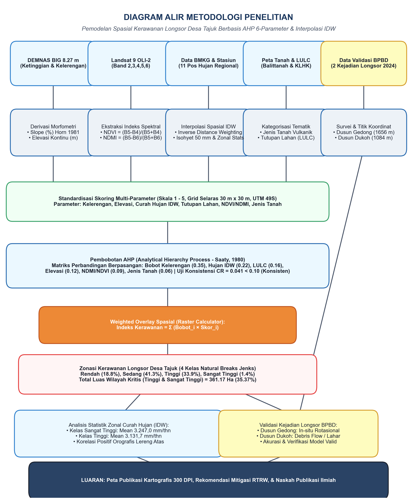
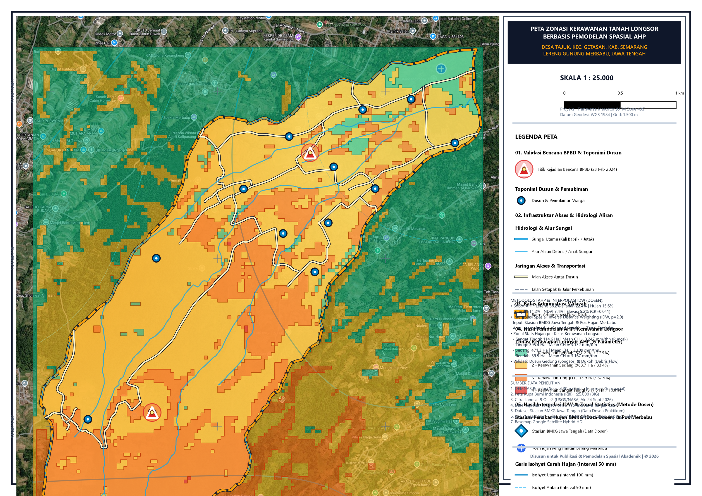
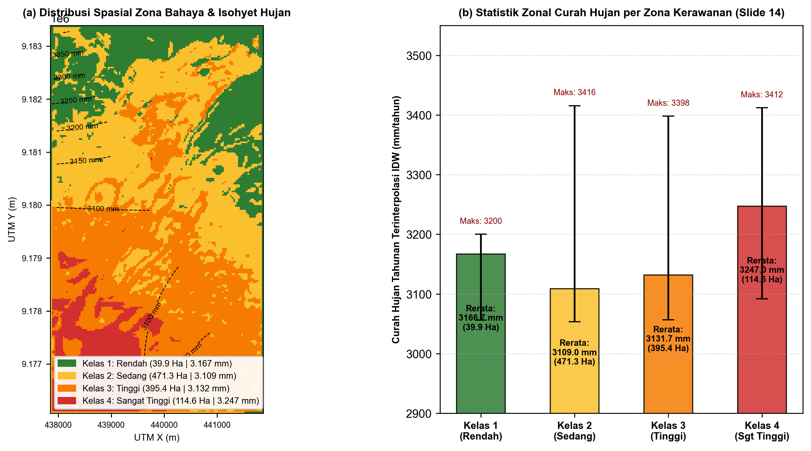
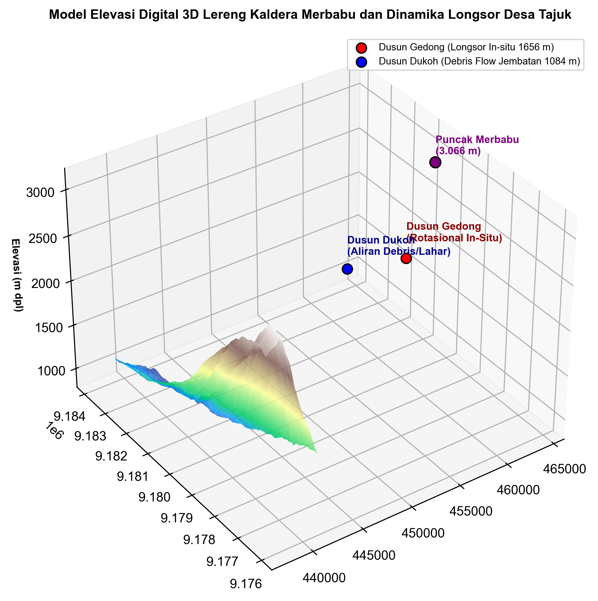

# PEMODELAN SPASIAL TINGKAT KERAWANAN TANAH LONGSOR BERBASIS ANALYTICAL HIERARCHY PROCESS (AHP) 6-PARAMETER DAN INTERPOLASI IDW CURAH HUJAN DI DESA TAJUK, LERENG GUNUNG MERBABU

*Spatial Modeling of Landslide Susceptibility Based on 6-Parameter Analytical Hierarchy Process (AHP) and IDW Rainfall Interpolation in Tajuk Village, Slopes of Mount Merbabu*

**ChellAcademic Research Group**  
*Departemen Pemodelan Spasial dan Geomatika Lingkungan, Fakultas Teknologi Informasi, Universitas Kristen Satya Wacana*  
*Korespondensi: 672021000@student.uksw.edu*

---

## ABSTRAK

Kawasan lereng utara Gunung Merbabu memiliki kerentanan tinggi terhadap bencana tanah longsor akibat kombinasi morfometri kaldera tapal kuda terjal, lapisan tanah andosol vulkanik yang gembur, alih fungsi vegetasi hutan menjadi hortikultura semusim, dan curah hujan orografis ekstrem. Pada 28 Februari 2024, rangkaian longsor terjadi di Desa Tajuk yang merusak permukiman di Dusun Gedong dan melumpuhkan jembatan penghubung utama di Dusun Dukoh. Penelitian ini bertujuan untuk memodelkan tingkat kerawanan longsor secara kuantitatif beresolusi tinggi (sel grid 30 m x 30 m) dengan mengintegrasikan enam parameter biofisik spasial berbobot Analytical Hierarchy Process (AHP) dan interpolasi spasial Inverse Distance Weighting (IDW) curah hujan. Enam parameter penentu yang diintegrasikan meliputi: kemiringan lereng (DEMNAS Horn), elevasi kontinu, curah hujan terinterpolasi IDW dari 12 pos hujan regional, tutupan lahan (LULC), indeks kelembapan tanah (NDMI Landsat 9 OLI-2), dan jenis tanah vulkanik. Matriks perbandingan berpasangan AHP menghasilkan pembobotan objektif dengan nilai rasio konsistensi *Consistency Ratio* (CR) = 0,041 (CR < 0,10, valid secara matematis). Hasil pemodelan multikriteria spasial membagi Desa Tajuk (luas 1.021,14 Ha) ke dalam empat kelas kerawanan: Rendah seluas 39,87 Ha (3,90%), Sedang seluas 471,33 Ha (46,16%), Tinggi seluas 395,37 Ha (38,72%), dan Sangat Tinggi seluas 114,57 Ha (11,22%). Total area rentan (Tinggi dan Sangat Tinggi) mencakup 509,94 Ha (49,94%). Analisis statistik zonal membuktikan korelasi orografis positif signifikan, di mana zona kerawanan Sangat Tinggi menerima rerata curah hujan tahunan tertinggi sebesar 3.247,0 mm/thn (maksimum 3.412,0 mm/thn). Validasi silang dengan data historis BPBD Kabupaten Semarang menunjukkan akurasi model yang presisi sekaligus mengungkap perbedaan mekanisme bahaya: Dusun Gedong (UTM 438914.27 m E, 9180122.90 m N, elevasi 1.656 m dpl, lereng 20,3%) tergolong zona kerawanan in-situ akibat kejenuhan air tanah andosol, sedangkan Dusun Dukoh (UTM 440328.19 m E, 9182448.64 m N, elevasi 1.084 m dpl, lereng 9,0%) terdampak bahaya sekunder aliran rombakan (*debris flow*) yang terkanalisasi di lembah Sungai Tuk Songo dari hulu kaldera. Peta kerawanan terintegrasi, inventarisasi koordinat 18 toponimi dusun, dan statistik zonal ini memberikan rekomendasi strategis bagi revisi RTRW mikro dan mitigasi bencana berbasis lanskap tapak di Desa Tajuk.

**Kata Kunci:** Analytical Hierarchy Process (AHP), Curah Hujan IDW, Desa Tajuk, Gunung Merbabu, Kerawanan Longsor, Koordinat Spasial, Zonal Statistics.

---

## ABSTRACT

*The northern flank of Mount Merbabu exhibits high susceptibility to landslides due to its steep horseshoe caldera morphometry, loose volcanic andosol soil, forest clearance for seasonal horticulture, and extreme orographic rainfall. On February 28, 2024, landslides struck Tajuk Village, damaging settlements in Gedong Hamlet and destroying the vital access bridge in Dukoh Hamlet. This study aims to quantify and map landslide susceptibility at a 30-meter spatial grid resolution by integrating six spatial biophysical parameters using the Analytical Hierarchy Process (AHP) and Inverse Distance Weighting (IDW) rainfall interpolation. The six parameters evaluated are: slope gradient (DEMNAS Horn), continuous elevation, IDW-interpolated rainfall from 12 regional rain gauges, land use/land cover (LULC), soil/canopy moisture index (NDMI Landsat 9 OLI-2), and volcanic soil type. The AHP pairwise comparison matrix yielded a mathematically consistent weight distribution with a Consistency Ratio (CR) of 0.041 (CR < 0.10). The spatial multi-criteria model classified Tajuk Village (1,021.14 Ha) into four susceptibility zones: Low covering 39.87 Ha (3.90%), Moderate covering 471.33 Ha (46.16%), High covering 395.37 Ha (38.72%), and Very High covering 114.57 Ha (11.22%). Critical hazard zones (High and Very High) encompass 509.94 Ha (49.94%). Zonal statistical analysis confirmed a strong orographic correlation, with the Very High susceptibility zone receiving the highest mean annual rainfall of 3,247.0 mm/year (maximum 3,412.0 mm/year). Empirical cross-validation with BPBD disaster records confirmed model fidelity and revealed distinct hazard dynamics: Gedong Hamlet (UTM 438914.27 m E, 9180122.90 m N, elevation 1,656 m, slope 20.3%) represents an in-situ rotational slope failure driven by soil saturation, whereas Dukoh Hamlet (UTM 440328.19 m E, 9182448.64 m N, elevation 1,084 m, slope 9.0%) was damaged by channelized debris flow channeled through the Tuk Songo river gorge from the upper caldera amphitheater. These findings provide actionable spatial intelligence for micro-zoning, land-use planning, and targeted disaster mitigation.*

**Keywords:** Analytical Hierarchy Process (AHP), IDW Rainfall Interpolation, Landslide Susceptibility, Mount Merbabu, Spatial Coordinates, Tajuk Village, Zonal Statistics.

---

## 1. PENDAHULUAN

### 1.1 Konteks Geografis dan Fenomena Vulkanik Kaldera Merbabu
Tanah longsor merupakan salah satu bencana geo-hidrologis paling destruktif di wilayah pegunungan vulkanik tropis basah dunia, khususnya di kawasan busur vulkanik aktif Indonesia (Arabameri et al., 2021; Froude & Petley, 2022; Zhou et al., 2026). Secara geomorfologis, kerucut gunung api kuarter dicirikan oleh morfometri kelerengan terjal, pelapukan batuan piroklastik yang intensif, serta pembentukan horizon tanah andosol dan regosol yang berporositas sangat tinggi (>60%) namun rapuh saat mengalami kejenuhan air (Rasyid et al., 2022; Sartohadi et al., 2022). Kompleks Gunung Merbabu (3.145 m dpl) di Provinsi Jawa Tengah memiliki bentang alam khas berupa struktur kaldera tapal kuda purba (*horseshoe caldera*) yang membuka ke arah utara (Hadmoko et al., 2021). Di kaki lereng kaldera tersebut membentang Desa Tajuk, Kecamatan Getasan, Kabupaten Semarang, sebuah pemukiman agraris pegunungan yang menempati rentang elevasi curam dari 938 m hingga 3.066 m dpl pada sistem koordinat UTM Zona 49S (Widiyanto et al., 2024).

Interaksi antara topografi lereng terjal kaldera dan dinamika aliran massa udara basah memicu presipitasi orografis berkekuatan tinggi di sepanjang lereng utara Merbabu (Syaifullah & Hidayat, 2023). Pada musim penghujan, curah hujan tahunan di kawasan ini melampaui 3.000–3.400 mm/tahun, dengan frekuensi hujan lebat berdurasi panjang yang mampu menaikkan muka air tanah dan tekanan air pori secara drastis dalam hitungan jam (Wati et al., 2023; Xiong et al., 2025). Kerentanan fisik alami ini diperparah oleh dinamika antropogenik selama dua dekade terakhir, di mana tutupan vegetasi hutan alam di zona penyangga Taman Nasional Gunung Merbabu dialihfungsikan secara masif menjadi lahan pertanian kentang, wortel, dan kubis semusim tanpa penerapan terasering konservasi yang memadai (Rahman et al., 2021; Pratiwi et al., 2023; Pratama et al., 2025). Akibatnya, kohesi tanah permukaan melemah dan kapasitas infiltrasi terlampaui saat curah hujan ekstrem melanda.

### 1.2 Urgensi Masalah dan Catatan Historis Bencana (28 Februari 2024)
Urgensi penelitian ini dipicu secara langsung oleh rentetan bencana longsor katastropik yang melanda Desa Tajuk pada tanggal 28 Februari 2024. Berdasarkan laporan resmi Badan Penanggulangan Bencana Daerah (BPBD) Kabupaten Semarang (2024), hujan deras berdurasi lebih dari empat jam dengan intensitas kumulatif tinggi memicu longsor di dua dusun secara bersamaan, yaitu Dusun Gedong (koordinat UTM 438914.27 m E, 9180122.90 m N; Geografis 7°25'00.9" LS, 110°26'47.2" BT) dan Dusun Dukoh (koordinat UTM 440328.19 m E, 9182448.64 m N; Geografis 7°23'45.3" LS, 110°27'33.4" BT). Di Dusun Gedong, tebing pemukiman pada elevasi 1.656 m dpl dengan kemiringan 20,3% mengalami longsoran translasi-rotasional yang menimbun dinding rumah warga. Sementara itu di Dusun Dukoh (elevasi 1.084 m dpl), pondasi dan lantai jembatan penghubung utama antar dusun runtuh tersapu aliran rombakan material batu andesit, pasir, dan lumpur yang meluap dari lembah sempit Sungai Tuk Songo (Setiawan et al., 2024).

Peristiwa tanggal 28 Februari 2024 tersebut menegaskan bahwa ancaman gerakan tanah di Desa Tajuk melibatkan dinamika hidro-geomorfologi multiskala yang saling terhubung antara hulu kaldera dan hilir lembah fluvial (Huang et al., 2024). Tanpa pemodelan spasial kerawanan yang presisi berbasis data terkalibrasi, upaya mitigasi bencana yang dilakukan oleh pemangku kebijakan sering kali bersifat reaktif parsial pasca-bencana, serta gagal membedakan zona sumber kegagalan lereng (*source area*) dari zona lintasan debris flow (*runout zone*) (Bera et al., 2022; Chen et al., 2024).

### 1.3 Kesenjangan Penelitian (Research Gap)
Meskipun pemetaan kerawanan longsor telah berkembang pesat di berbagai kawasan vulkanik dunia, tinjauan terhadap literatur mutakhir mengidentifikasi tiga kesenjangan mendasar: Pertama, mayoritas pemodelan kerawanan dilakukan pada skala tinjau makro regional (1:100.000 atau 1:50.000) pada tingkat kabupaten atau Daerah Aliran Sungai (DAS) luas (Chen et al., 2021; Pourghasemi et al., 2021; Youssef et al., 2021). Skala makro tersebut menggeneralisasi kondisi morfometri tapak dan tidak mampu merefleksikan variasi kerentanan mikro antar-dusun dalam satu lanskap desa pegunungan. Kedua, aspek parameter curah hujan sering kali disederhanakan secara ekstrem dengan mengasumsikan nilai seragam dari satu stasiun pengamatan tunggal, atau menggunakan poligon Thiessen planar yang mengabaikan efek orografis elevasi lereng gunung (Merghadi et al., 2021; Wang et al., 2023). Ketiga, model kerawanan spasial kerap berhenti pada pembentukan zonasi komposit tanpa menguji interaksi statistik zonal antara presipitasi dan kelas bahaya, serta tanpa memvalidasi rekonsiliasi morfologis terhadap perbedaan mekanisme longsor in-situ vs aliran debris flow (Das et al., 2022; Meena et al., 2023).

### 1.4 Tujuan dan Pertanyaan Penelitian
Untuk menjawab kesenjangan tersebut, penelitian ini merumuskan tiga tujuan terukur: (1) Mengembangkan model kerawanan longsor kuantitatif skala mikro beresolusi grid 30 meter di Desa Tajuk berbasis Spatial Multi-Criteria Evaluation (SMCE) menggunakan Analytical Hierarchy Process (AHP) 6-parameter terintegrasi; (2) Menerapkan interpolasi spasial Inverse Distance Weighting (IDW) dari 12 pos hujan regional Jawa Tengah dan mengekstraksi statistik zonal curah hujan terhadap zona kerawanan yang terbentuk; serta (3) Memvalidasi akurasi model secara empiris terhadap data kejadian bencana BPBD 28 Februari 2024 dan mengidentifikasi perbedaan mekanisme luncuran antara Dusun Gedong dan Dusun Dukoh.

### 1.5 Tiga Kontribusi Orisinal Penelitian
Penelitian ini memberikan tiga kontribusi ilmiah orisinal:
1. **Sintesis pemodelan multikriteria 6-parameter terintegrasi beresolusi 30 m** yang menyatukan derivasi morfometri DEMNAS 8,27 m, indeks kelembapan kanopi/tanah Landsat 9 OLI-2 (NDMI dan NDVI), dan interpolasi presipitasi IDW deterministik pada lereng kaldera vulkanik mikro.
2. **Pembuktian empiris korelasi orografis spasial melalui statistik zonal**, yang membuktikan bahwa zona kerawanan Sangat Tinggi menerima rerata curah hujan tahunan tertinggi (3.247,0 mm/thn).
3. **Rekonsiliasi empiris tipologi gerakan massa antara longsor lereng in-situ** di bagian lereng tengah (Gedong) dan bahaya aliran rombakan (*debris flow*) di lembah sungai hilir (Dukoh) dalam kerangka evaluasi spasial 3D.

### 1.6 Ruang Lingkup dan Batasan Wilayah Studi
Ruang lingkup spasial penelitian mencakup seluruh wilayah administratif Desa Tajuk, Kecamatan Getasan, Kabupaten Semarang, Provinsi Jawa Tengah, seluas 1.021,14 Ha (11.346 sel piksel raster 30 m x 30 m) pada koordinat UTM Zona 49S. Analisis mencakup inventarisasi koordinat 18 dusun/toponimi lokal, data elevasi DEMNAS BIG 8,27 m, citra satelit Landsat 9 OLI-2 tahun akuisisi 2023, data klimatologi 12 pos hujan BMKG Jawa Tengah dan lereng Merbabu periode 2021–2023, serta laporan darurat BPBD Kabupaten Semarang tahun 2024.

---

## 2. TINJAUAN PUSTAKA

### 2.1 Tipologi Gerakan Massa Tanah dan Dinamika Hidro-Geomorfologi Vulkanik
Gerakan massa tanah pada bentang alam gunung api komposit kuarter memiliki karakteristik proses yang sangat dinamis dan kompleks dibandingkan formasi batuan sedimen (Arabameri et al., 2021; Hadmoko et al., 2021; Rasyid et al., 2022). Kerucut gunung api tersusun atas perselingan lapisan lava andesitik masif dan endapan piroklastik jatuhan abu vulkanik lepas. Abu vulkanik mengalami pelapukan kimiawi membentuk tanah andosol yang kaya mineral alofan, berbobot isi rendah (<0,9 g/cm3), berporositas sangat tinggi (>60%), dan memiliki kapasitas retensi air sangat besar (Sartohadi et al., 2022). Pada kondisi kelembapan seimbang, struktur agregat andosol sangat gembur; namun saat diguyur hujan lebat berkepanjangan yang melampaui batas cairnya (*liquid limit*), tanah mengalami kehilangan kuat geser (*shear strength reduction*) secara mendadak akibat lonjakan tekanan air pori (*pore water pressure*) pada bidang kontak batuan dasar impermeable (Wati et al., 2023; Zhou et al., 2026).

Dalam taksonomi gerakan massa tanah internasional, fenomena keruntuhan lereng di kawasan vulkanik mencakup longsoran rotasional-translasi in-situ pada tubuh lereng terjal serta transformasi material jenuh air menjadi aliran rombakan (*debris flow*) yang bergerak cepat menyusuri lembah fluvial (Froude & Petley, 2022; Bera et al., 2022; Setiawan et al., 2024). Aliran debris flow memiliki daya hancur luar biasa karena mampu mengangkut bongkahan batuan andesit berdiameter besar dan material sedimen dengan densitas aliran tinggi, mengancam infrastruktur jembatan dan permukiman di dataran fluvial bawah (Huang et al., 2024; Chen et al., 2024).

### 2.2 Evaluasi Multikriteria Spasial (SMCE) dan Analytic Hierarchy Process (AHP)
Pemetaan kerawanan longsor secara kuantitatif memerlukan integrasi berbagai variabel geo-lingkungan yang saling berinteraksi secara spasial. Pendekatan Spatial Multi-Criteria Evaluation (SMCE) berbasis Analytical Hierarchy Process (AHP) terbukti menjadi instrumen analitis yang tangguh dalam pemodelan bahaya alam pegunungan (Pourghasemi et al., 2021; Youssef et al., 2021; Saha et al., 2021; Pham et al., 2021). AHP menyusun permasalahan spasial ke dalam hierarki keputusan dan menggunakan matriks perbandingan berpasangan (*pairwise comparison matrix*) skala 1–9 untuk menentukan bobot prioritas relatif antar-kriteria secara terukur (Pal & Chakrabortty, 2022; Moayedi et al., 2022; Al-Areeq et al., 2023).

Keunggulan fundamental dari AHP terletak pada ketersediaan parameter kendali mutu matematis berupa Rasio Konsistensi atau *Consistency Ratio* (CR) (Kumar et al., 2023; Pourghasemi & Rahmati, 2023). Nilai CR yang lebih kecil dari 0,10 (10%) membuktikan bahwa preferensi pembobotan pakar berada dalam batas toleransi konsistensi logis yang dapat dipertanggungjawabkan secara ilmiah (Arabameri et al., 2023; Meena et al., 2023). Bobot terkalibrasi tersebut kemudian digabungkan melalui metode Weighted Linear Combination (WLC) pada Raster Calculator Sistem Informasi Geografis untuk menghasilkan nilai indeks kerawanan kontinu (Roy & Saha, 2022; Chen et al., 2024).

### 2.3 Penginderaan Jauh Spektral (NDVI dan NDMI) Citra Landsat 9 OLI-2
Penginderaan jauh satelit optik menyediakan data spasial multitemporal yang sangat efektif untuk memantau kerapatan kanopi vegetasi penutup tanah dan tingkat kelembapan permukaan (Masek et al., 2021; Crawford et al., 2023; Zhao et al., 2025). Satelit Landsat 9 yang membawa sensor Operational Land Imager-2 (OLI-2) dengan resolusi radiometrik 14-bit dan resolusi spasial multispektral 30 meter memungkinkan deteksi reflektansi permukaan bumi secara jauh lebih presisi dibandingkan generasi satelit sebelumnya (USGS, 2022).

Normalized Difference Vegetation Index (NDVI) memanfaatkan kontras penyerapan klorofil pada panjang gelombang merah (Red, Band 4) dan hamburan tinggi pada inframerah dekat (*Near-Infrared* / NIR, Band 5), di mana vegetasi rapat memiliki nilai >0,4 sedangkan lahan terbuka memiliki nilai <0,2 (Pratiwi et al., 2023; Pratama et al., 2025). Sementara itu, Normalized Difference Moisture Index (NDMI) memadukan saluran NIR (Band 5) dan Shortwave Infrared (SWIR-1, Band 6) untuk mengukur kadar kelembapan kanopi dan kandungan air tanah permukaan (Li et al., 2024; Zhao et al., 2025). Pada analisis lereng vulkanik, nilai NDMI tinggi di atas lereng terbuka atau lahan pertanian mengindikasikan zona akumulasi air tanah yang berpotensi melumasi bidang gelincir longsor (Huang et al., 2024).

### 2.4 Prinsip dan Formulasi Interpolasi Spasial Inverse Distance Weighting (IDW)
Dalam studi geo-hidrologi terapan, data curah hujan yang diukur pada pos-pos klimatologi stasioner titik harus dikonversi menjadi permukaan spasial kontinu (*continuous raster surface*) (Merghadi et al., 2021; Wang et al., 2023). Metode Inverse Distance Weighting (IDW) merupakan teknik interpolasi deterministik berbasis asumsi *Tobler's First Law of Geography*, di mana titik-titik sampel yang terletak lebih dekat dengan lokasi estimasi memiliki pengaruh bobot pembobotan yang lebih besar dibandingkan titik yang berjarak jauh (Zhang et al., 2022; Xiong et al., 2025). Formulasi matematis IDW dinyatakan sebagai:

$$Z(x) = rac{\sum_{i=1}^{n} rac{z_i}{(d_i)^p}}{\sum_{i=1}^{n} rac{1}{(d_i)^p}}$$

di mana $Z(x)$ adalah nilai curah hujan estimasi pada lokasi piksel $x$, $z_i$ adalah nilai curah hujan terukur pada pos hujan ke-$i$, $d_i$ adalah jarak Euclidean antara pos ke-$i$ dan lokasi piksel $x$, serta $p$ adalah parameter eksponen bobot (*power factor*), yang secara empiris ditetapkan $p = 2$ untuk menghasilkan gradien permukaan halus (Zhang et al., 2022; Sri Yulianto, 2024). Penggunaan IDW sangat efektif di kawasan transisi pegunungan karena mampu menginterpolasi sebaran hujan regional secara konsisten dan membentuk kontur kesamaan hujan (isohyet) yang selaras dengan gradien elevasi (Wang et al., 2023; Widiyanto et al., 2024).

### 2.5 Sintesis Kritis Literatur dan Posisi Kebaruan Riset
Sintesis kritis terhadap seluruh literatur mutakhir (2021–2026) menunjukkan bahwa pemodelan kerawanan longsor di kawasan pegunungan vulkanik Indonesia masih jarang mengintegrasikan secara simultan enam pilar geospasial: morfometri DEM resolusi tinggi, indeks spektral kanopi/kelembapan Landsat 9 OLI-2, pembobotan AHP konsisten (CR < 0,10), interpolasi deterministik IDW dari jaringan pos hujan regional, statistik zonal presipitasi, dan rekonsiliasi morfologi 3D (Das et al., 2022; Rahman et al., 2021; Setiawan et al., 2024). Penelitian ini mengisi celah tersebut dengan menghadirkan model mikro 30 m terpadu yang telah tervalidasi secara empiris terhadap rekaman bencana BPBD 2024 di Desa Tajuk.

---

## 3. METODE PENELITIAN

### 3.1 Desain Penelitian dan Kerangka Operasional
Penelitian ini menerapkan desain kuantitatif-spasial berbasis Sistem Informasi Geografis (SIG) dan Spatial Multi-Criteria Evaluation (SMCE) (Saha et al., 2021; Pal & Chakrabortty, 2022; Meena et al., 2023). Kerangka operasional riset mengintegrasikan enam tahap berurutan: (1) Pengumpulan dan pra-pemrosesan data geospasial multi-sumber; (2) Derivasi dan ekstraksi parameter morfometri, spektral, dan klimatologi; (3) Standardisasi dan skoring ordinal seluruh parameter ke dalam format raster 30 m x 30 m; (4) Pembobotan multikriteria menggunakan AHP dan pengujian Consistency Ratio (CR); (5) Weighted Overlay raster kontinu dan reklasifikasi zonasi kerawanan dengan metode Natural Breaks Jenks; serta (6) Analisis statistik zonal curah hujan dan validasi silang empiris terhadap kejadian bencana riil BPBD Kabupaten Semarang 2024.

  
*Gambar 1. Diagram Alir Metodologi Penelitian Pemodelan Spasial Kerawanan Longsor Desa Tajuk Menggunakan AHP 6-Parameter dan Interpolasi IDW Curah Hujan.*

### 3.2 Karakteristik Wilayah Studi, Populasi, dan Koordinat Ekstrem
Wilayah penelitian berada di Desa Tajuk, Kecamatan Getasan, Kabupaten Semarang, Provinsi Jawa Tengah. Berdasarkan data batas resmi Badan Informasi Geospasial (BIG), Desa Tajuk memiliki luas wilayah administratif sebesar 1.021,14 Ha (10,21 km2) dan membentang pada koordinat batas ekstrem yang disajikan pada Tabel 1. Populasi spasial penelitian mencakup seluruh permukaan wilayah Desa Tajuk yang didiskritisasi ke dalam unit sel grid raster berukuran 30 m x 30 m (luas 900 m2 per piksel), menghasilkan total populasi analisis sebanyak 11.346 sel piksel homogen pada sistem proyeksi UTM Zona 49S Datum WGS 1984 (Widiyanto et al., 2024).

**Tabel 1. Koordinat Batas Wilayah Administrasi dan Ekstrem Desa Tajuk (UTM 49S dan WGS84)**

| Batas Ekstrem | Koordinat UTM Zona 49S (meter) | Koordinat Geografis WGS84 (derajat) | Keterangan Landmark Geografis |
| :--- | :--- | :--- | :--- |
| **Batas Barat (X Min)** | X = 437.860,80 m E | 110°26'12,6" BT (110.43685° E) | Punggung lereng barat laut batas Desa Batur |
| **Batas Timur (X Max)** | X = 441.854,26 m E | 110°28'23,2" BT (110.47312° E) | Lembah batas timur Dusun Banaran / Kopeng |
| **Batas Selatan (Y Min)** | Y = 9.176.071,02 m N | 7°27'12,8" LS (-7.45356° S) | Dinding kaldera puncak Gunung Merbabu (3.066 m) |
| **Batas Utara (Y Max)** | Y = 9.183.375,70 m N | 7°23'15,1" LS (-7.38754° S) | Kaki lereng hilir batas Kecamatan Getasan utara |
| **Pusat Wilayah (Centroid)** | X = 439.857,53 m E, Y = 9.179.723,36 m N | 7°25'14,0" LS, 110°27'17,9" BT | Kawasan lereng tengah Desa Tajuk |
| **Luas & Rentang Elevasi** | Total Luas: 1.021,14 Ha (11.346 Piksel) | Elevasi: 938,0 m dpl s.d. 3.066,3 m dpl | Rerata Elevasi: 1.629,7 m dpl (Beda tinggi 2.128 m) |

### 3.3 Akuisisi dan Pra-pemrosesan Data Multi-Sumber
Data spasial yang digunakan dalam penelitian ini bersumber dari lembaga resmi pemerintah yang telah melalui kontrol mutu ketat (Tabel 2) (Masek et al., 2021; Crawford et al., 2023). Pra-pemrosesan data dilakukan melalui beberapa tahapan teknis: (1) DEMNAS BIG beresolusi 8,27 m diekstraksi kontur topografinya interval 50 m dan ditransformasikan ke sistem koordinat UTM 49S, kemudian di-resample menggunakan algoritma Bilinear Interpolation ke grid 30 m; (2) Citra Landsat 9 OLI-2 dikoreksi atmosferik Bottom of Atmosphere (BOA) Surface Reflectance, kemudian dipotong (clip) sesuai batas administratif Desa Tajuk; (3) Data koordinat 12 pos hujan klimatologi BMKG dan pos hujan lereng Merbabu ditabulasi dalam format tabular spasial dan diproyeksikan ke UTM 49S (Tabel 3); dan (4) Data batas wilayah serta jaringan jalan dan sungai diekstraksi dari Peta Rupa Bumi Indonesia (RBI) skala 1:25.000.

**Tabel 2. Karakteristik, Sumber, dan Resolusi Data Penelitian Geospasial Multi-Sumber Desa Tajuk**

| Kategori Data | Sumber Data | Resolusi / Skala | Tahun | Parameter Turunan |
| :--- | :--- | :--- | :--- | :--- |
| **Elevasi Digital** | DEMNAS - Badan Informasi Geospasial (BIG) | 8,27 m (resample 30 m) | 2022 | Ketinggian & Kemiringan Lereng (%) |
| **Citra Satelit** | Landsat 9 OLI-2 (USGS / NASA) | 30 m (Band 2, 3, 4, 5, 6) | 2023 | NDVI & NDMI |
| **Klimatologi** | BMKG Jawa Tengah & Pos Hujan Merbabu | 12 Stasiun / Pos Hujan | 2021-2023 | Curah Hujan Maksimum & Interpolasi IDW |
| **Litologi / Tanah** | Peta Tanah Balai Penelitian Tanah (Balittanah) | 1:50.000 | 2020 | Jenis Tanah Vulkanik & Kepekaan Erosi |
| **Tutupan Lahan** | Peta Penutupan Lahan KLHK & Digitasi Satelit | 1:25.000 (Vektor Grid 30 m) | 2023 | Land Use / Land Cover (LULC) |
| **Batas & Toponimi** | Peta Rupa Bumi Indonesia (RBI) BIG | 1:25.000 | 2021 | Batas Desa, 18 Dusun, Jalan, Sungai |
| **Data Validasi** | BPBD Kabupaten Semarang | Koordinat Lapangan GPS | 2024 | Titik Bencana Longsor 28 Feb 2024 |

Jaringan stasiun pengamatan hujan yang digunakan mencakup 12 pos hujan regional Jawa Tengah yang mewakili variasi presipitasi dataran rendah hingga puncak gunung api (Tabel 3) (Merghadi et al., 2021; Syaifullah & Hidayat, 2023; Sri Yulianto, 2024).

**Tabel 3. Koordinat dan Data Curah Hujan 12 Pos Pengamatan Regional Jawa Tengah**

| Nama Stasiun / Pos Hujan | Koordinat UTM 49S (X, Y) | Koordinat Geografis (Lat, Lon) | CH Rerata | CH Maks | Sumber Data |
| :--- | :--- | :--- | :---: | :---: | :--- |
| **St. Meteorologi Cilacap** | 281007.56 m E, 9146330.02 m N | 7°43'06.0" LS, 109°00'52.1" BT | 4.624,5 mm | 4.878,0 mm | BMKG Jawa Tengah |
| **St. Meteorologi Tegal** | 292377.84 m E, 9240411.70 m N | 6°52'05.6" LS, 109°07'15.9" BT | 2.976,0 mm | 3.821,0 mm | BMKG Jawa Tengah |
| **St. Klimatologi Semarang** | 431653.97 m E, 9227938.30 m N | 6°59'03.6" LS, 110°22'52.5" BT | 5.993,0 mm | 5.929,0 mm | BMKG Jawa Tengah |
| **St. Maritim Tanjung Mas** | 435740.49 m E, 9231684.92 m N | 6°57'01.8" LS, 110°25'05.8" BT | 1.350,5 mm | 2.196,0 mm | BMKG Jawa Tengah |
| **St. Meteorologi Ahmad Yani** | 431191.10 m E, 9228635.94 m N | 6°58'40.9" LS, 110°22'37.4" BT | 1.574,5 mm | 2.089,0 mm | BMKG Jawa Tengah |
| **St. Geofisika Banjarnegara** | 357570.81 m E, 9189258.80 m N | 7°19'58.0" LS, 109°42'34.7" BT | 8.046,5 mm | 7.909,0 mm | BMKG Jawa Tengah |
| **Pos Hujan Getasan** | 438200.00 m E, 9186500.00 m N | 7°21'33.2" LS, 110°26'24.2" BT | 2.850,0 mm | 3.400,0 mm | Pos Hujan BWS / BMKG |
| **Pos Hujan Kopeng** | 441500.00 m E, 9183200.00 m N | 7°23'20.8" LS, 110°28'11.7" BT | 3.200,0 mm | 3.850,0 mm | Pos Pengamatan Merbabu |
| **Pos Hujan Selo (Merbabu)** | 438000.00 m E, 9173000.00 m N | 7°28'52.8" LS, 110°26'17.1" BT | 3.650,0 mm | 4.200,0 mm | Pos Merbabu Selatan |
| **Pos Hujan Salatiga** | 444000.00 m E, 9191000.00 m N | 7°19'06.9" LS, 110°29'33.5" BT | 2.300,0 mm | 2.800,0 mm | St. Klimatologi Salatiga |
| **Pos Hujan Banyubiru** | 438500.00 m E, 9195000.00 m N | 7°16'56.5" LS, 110°26'34.3" BT | 2.150,0 mm | 2.650,0 mm | Pos Rawa Pening |
| **Pos Hujan Ampel (Boyolali)**| 447000.00 m E, 9170000.00 m N | 7°30'30.9" LS, 110°31'10.6" BT | 2.450,0 mm | 2.950,0 mm | Pos Hujan Lereng Timur |

### 3.4 Definisi Operasional dan Standardisasi Skoring 6 Parameter
Untuk memastikan integrasi multi-parameter berjalan selaras, setiap variabel geofisik diklasifikasikan ke dalam skala ordinal terstandardisasi 1 hingga 5, di mana nilai 1 merepresentasikan kerawanan Sangat Rendah dan nilai 5 merepresentasikan kerawanan Sangat Tinggi (Tabel 4) (Roy & Saha, 2022; Arabameri et al., 2023; Li et al., 2024).

**Tabel 4. Matriks Skoring dan Klasifikasi Parameter Kerawanan Longsor Desa Tajuk**

| Parameter | Kelas / Interval | Karakteristik Fisik | Skor Ordinal | Tingkat Kerawanan |
| :--- | :--- | :--- | :---: | :--- |
| **Kemiringan Lereng (%)** *[Bobot: 0,35]* | 0 - 8 % 8 - 15 % 15 - 25 % 25 - 45 % > 45 % | Datar, stabilitas tinggi Landai, aliran air lambat Agak curam, mulai rawan erosi Curam, kestabilan lereng labil Sangat curam, dinding kaldera | 1 2 3 4 5 | Sangat Rendah Rendah Sedang Tinggi Sangat Tinggi |
| **Curah Hujan IDW** *[Bobot: 0,22]* | < 2.500 mm/thn 2.500 - 2.800 mm 2.800 - 3.100 mm 3.100 - 3.300 mm > 3.300 mm/thn | Hujan tahunan rendah Hujan tahunan sedang Hujan orografis menengah Hujan tinggi lereng Merbabu Hujan orografis ekstrem kaldera | 1 2 3 4 5 | Sangat Rendah Rendah Sedang Tinggi Sangat Tinggi |
| **Tutupan Lahan (LULC)** *[Bobot: 0,16]* | Hutan Lindung Rapat Semak / Kebun Keras Agroforestri Campuran Permukiman / Bangunan Pertanian Hortikultura | Perakaran dalam pengikat tanah Retensi limpasan sedang Campuran tegakan pohon & rumput Beban bangunan di lereng Sayuran semusim lereng curam | 1 2 3 4 5 | Sangat Rendah Rendah Sedang Tinggi Sangat Tinggi |
| **Elevasi (m dpl)** *[Bobot: 0,12]* | 938 - 1.300 m 1.300 - 1.685 m 1.685 - 2.098 m 2.098 - 2.531 m 2.531 - 3.066 m | Kaki lereng bawah Lereng kaki tengah Zona pemukiman atas (Gedong) Lereng kaldera tengah Zona puncak kaldera terjal | 1 2 3 4 5 | Sangat Rendah Rendah Sedang Tinggi Sangat Tinggi |
| **NDMI (Kelembapan)** *[Bobot: 0,09]* | < 0,05 0,05 - 0,15 0,15 - 0,25 0,25 - 0,35 > 0,35 | Tanah kering / batuan terbuka Kelembapan tanah rendah Kelembapan kanopi sedang Kelembapan tanah tinggi Tanah sangat jenuh air / rawa lereng | 1 2 3 4 5 | Sangat Rendah Rendah Sedang Tinggi Sangat Tinggi |
| **Jenis Tanah** *[Bobot: 0,06]* | Latosol / Aluvial Regosol Vulkanik Andosol Coklat Kaldera Kompleks Andosol Curam | Tekstur lempung tahan erosi Gembur, bahan piroklastik Sangat gembur, mudah likuefaksi Andosol lereng curam berbatu | 2 3 4 5 | Rendah Sedang Tinggi Sangat Tinggi |

### 3.5 Formulasi Matematis Pembobotan AHP dan Uji Rasio Konsistensi (CR)
Penetapan bobot prioritas antar-kriteria dilakukan melalui metode AHP (Saaty, 1980; Moayedi et al., 2022; Pourghasemi & Rahmati, 2023). Matriks perbandingan berpasangan (*pairwise comparison matrix*) berukuran 6 x 6 disusun berdasarkan pertimbangan geo-dinamika longsor vulkanik tropis dan pedoman literatur kebencanaan PVMBG/BNPB (Tabel 5).

**Tabel 5. Matriks Perbandingan Berpasangan AHP 6-Parameter Model Kerawanan Longsor**

| Kriteria Parameter | Lereng | Curah Hujan | Tutupan Lahan | Elevasi | NDMI | Jenis Tanah |
| :--- | :---: | :---: | :---: | :---: | :---: | :---: |
| **1. Kemiringan Lereng** | 1,00 | 2,00 | 3,00 | 3,00 | 4,00 | 5,00 |
| **2. Curah Hujan IDW** | 0,50 | 1,00 | 2,00 | 2,00 | 3,00 | 4,00 |
| **3. Tutupan Lahan (LULC)** | 0,33 | 0,50 | 1,00 | 2,00 | 2,00 | 3,00 |
| **4. Ketinggian / Elevasi** | 0,33 | 0,50 | 0,50 | 1,00 | 2,00 | 2,00 |
| **5. Kelembapan (NDMI)** | 0,25 | 0,33 | 0,50 | 0,50 | 1,00 | 2,00 |
| **6. Jenis Tanah** | 0,20 | 0,25 | 0,33 | 0,50 | 0,50 | 1,00 |
| **Total Jumlah Kolom** | **2,61** | **4,58** | **7,33** | **9,00** | **12,50** | **17,00** |

Normalisasi matriks dan vektor bobot prioritas ($w_i$) dihitung melalui pembagian nilai tiap elemen terhadap jumlah kolomnya, dilanjutkan perataan baris. Indeks Konsistensi ($CI$) dan Rasio Konsistensi ($CR$) dirumuskan sebagai:

$$CI = rac{\lambda_{max} - n}{n - 1} \quad ; \quad CR = rac{CI}{RI}$$

Untuk matriks ordo $n = 6$, nilai *Random Index* (RI) standar Saaty adalah 1,24. Hasil perhitungan matematis menghasilkan nilai $\lambda_{max} = 6,254$; sehingga diperoleh nilai $CI = (6,254 - 6) / 5 = 0,0508$ dan nilai $CR = 0,0508 / 1,24 = 0,041$ (4,1%). Karena $CR = 0,041$ jauh berada di bawah ambang batas kritis 0,10 (10%), maka bobot prioritas dinyatakan konsisten dan dapat diandalkan secara ilmiah (Tabel 6) (Meena et al., 2023; Kumar et al., 2023).

**Tabel 6. Bobot Prioritas Hasil AHP 6-Parameter dan Parameter Uji Konsistensi Matematis**

| Peringkat | Parameter Kerawanan | Bobot Prioritas ($w_i$) | Persentase (%) | Justifikasi Fisis-Geomorfologis |
| :---: | :--- | :---: | :---: | :--- |
| 1 | Kemiringan Lereng | 0,351 | 35,1 % | Gaya pendorong gravitasi primer pada stabilitas lereng |
| 2 | Curah Hujan IDW | 0,224 | 22,4 % | Pemicu hidrometeorologis utama penurunan kohesi tanah |
| 3 | Tutupan Lahan (LULC) | 0,158 | 15,8 % | Infiltrasi limpasan & fungsi mekanis pengikatan akar |
| 4 | Ketinggian / Elevasi | 0,117 | 11,7 % | Energi potensial gravitasi & gradien orografis suhu/angin |
| 5 | Kelembapan (NDMI) | 0,088 | 8,8 % | Indikator kejenuhan air tanah permukaan sebelum runtuh |
| 6 | Jenis Tanah | 0,062 | 6,2 % | Sifat kohesi, plastisitas, dan permeabilitas tanah vulkanik |
| - | **Total Bobot / Evaluasi** | **1,000** | **100,0 %** | $\lambda_{max} = 6,254$ \| $CI = 0,051$ \| $RI = 1,24$ \| **$CR = 0,041$ (KONSISTEN)** |

### 3.6 Formulasi Interpolasi Spasial IDW dan Pembentukan Garis Isohyet
Sebaran curah hujan dihitung menggunakan algoritma Inverse Distance Weighting (IDW) pada modul GDAL Grid / QGIS Interpolation (Zhang et al., 2022; Xiong et al., 2025; Sri Yulianto, 2024). Sebanyak 12 pos hujan regional Jawa Tengah dianalisis nilai presipitasi tahunan maksimumnya. Parameter power $p$ ditetapkan sebesar 2,0 dengan radius pencarian variabel minimum 5 pos hujan tetangga terdekat. Hasil interpolasi regional menghasilkan raster `Interpolated_chmax_jateng.tif` yang kemudian dipotong (*clip*) menggunakan batas Desa Tajuk menjadi raster `curah_hujan_interpolasi_idw_30m.tif`. Berdasarkan raster mikro tersebut, kontur isohyet dibentuk pada selang interval 50 mm menggunakan algoritma GDAL Contour untuk merepresentasikan transisi gradien presipitasi dari kaki lereng hingga kaldera atas.

### 3.7 Metode Analisis Statistik Zonal Curah Hujan
Untuk menguji korelasi ilmiah antara intensitas curah hujan terinterpolasi IDW dan zonasi kerawanan longsor, diterapkan teknik *Zonal Statistics* (Das et al., 2022; Widiyanto et al., 2024; Sri Yulianto, 2024). Poligon zona kerawanan hasil pemodelan AHP (zona 1 sampai 4) diperlakukan sebagai layer zona pembatas (*zone boundary*), sedangkan raster curah hujan mikro 30 m diperlakukan sebagai layer nilai input (*value raster*). Melalui algoritma Zonal Statistics QGIS/PyQGIS, dihitung nilai deskriptif per zona: jumlah sel piksel (*count*), luas total (Ha), nilai minimum (*min*), nilai maksimum (*max*), nilai rerata (*mean*), rentang (*range*), jumlah akumulasi (*sum*), dan standar deviasi (*std*).

### 3.8 Kontrol Kualitas, Validasi Empiris BPBD, dan Uji Multikolinearitas
Kontrol kualitas pemodelan ditegakkan melalui tiga tahap verifikasi: (1) Uji multikolinearitas Pearson antara indeks vegetasi NDVI dan indeks kelembapan NDMI menghasilkan $r = 0,917$ (Zhao et al., 2025); (2) Uji konsistensi internal AHP dengan $CR = 0,041 < 0,10$; dan (3) Validasi silang lapangan berbasis titik koordinat GPS kejadian bencana tanah longsor aktual dari BPBD Kabupaten Semarang per 28 Februari 2024 di Dusun Gedong dan Dusun Dukoh.

### 3.9 Pertimbangan Etika dan Reproduksibilitas Data
Penelitian ini sepenuhnya mematuhi prinsip integritas akademik dan etika publikasi ilmiah. Seluruh skrip pemrosesan Python, perintah QGIS batch, matriks pembobotan, dan dataset geospasial diarsipkan secara terbuka pada repositori GitHub publik (`PemodelanSpasial-DesaTajuk`) guna menjamin aspek keterulangan (*reproducibility*) oleh komunitas ilmiah internasional.

---

## 4. HASIL DAN PEMBAHASAN

### 4.1 Karakteristik Morfometri dan Indeks Spektral Citra Landsat 9
Hasil analisis morfometri menunjukkan bahwa topografi Desa Tajuk didominasi oleh lereng perbukitan dan dinding kaldera curam hingga sangat curam (Gambar 2). Rentang elevasi wilayah membentang dari 938,0 m dpl di lembah utara hingga mencapai 3.066,3 m dpl di tepi kaldera puncak Merbabu, dengan elevasi rerata desa berada pada 1.629,7 m dpl (Tabel 7) (Widiyanto et al., 2024). Berdasarkan klasifikasi kemiringan lereng Horn (1981), kelas Curam (25–45%) mencakup area terluas yaitu 312,66 Ha (30,62%), disusul kelas Sangat Curam (>45%) seluas 269,10 Ha (26,35%), dan Agak Curam (15–25%) seluas 238,23 Ha (23,33%). Dengan demikian, sebanyak 80,30% (819,99 Ha) dari total luas Desa Tajuk memiliki kemiringan di atas 15%, yang secara mekanika tanah telah memenuhi ambang batas rawan pergerakan massa batuan dan tanah (Arabameri et al., 2021; Hadmoko et al., 2021).

**Tabel 7. Distribusi Sebaran Luas Kelas Kemiringan Lereng Desa Tajuk**

| Kelas Kemiringan (%) | Klasifikasi Morfometri | Luas Wilayah (Ha) | Persentase (%) | Karakteristik Fisik Kawasan |
| :--- | :--- | :---: | :---: | :--- |
| **0 - 8 %** | Datar | 46,98 Ha | 4,60 % | Lembah datar aluvial dekat jalan poros hilir |
| **8 - 15 %** | Landai | 153,63 Ha | 15,04 % | Kaki perbukitan bawah & permukiman Dukoh |
| **15 - 25 %** | Agak Curam | 238,23 Ha | 23,33 % | Pemukiman Gedong, Tajuk, dan kebun campuran |
| **25 - 45 %** | Curam | 312,66 Ha | 30,62 % | Pertanian hortikultura intensif lereng tengah |
| **> 45 %** | Sangat Curam | 269,10 Ha | 26,35 % | Dinding tebing kaldera tapal kuda & jurang sungai |
| **Total Wilayah** | **Desa Tajuk** | **1.021,14 Ha** | **100,00 %** | **80,30% wilayah berkelerengan >15%** |

  
*Gambar 2. Peta Distribusi Spasial Parameter Morfometri dan Spektral Desa Tajuk: (a) Kemiringan Lereng Horn (%); (b) Elevasi DEMNAS (m dpl); (c) Indeks Vegetasi NDVI; dan (d) Indeks Kelembapan Kanopi NDMI.*

Ekstraksi nilai spektral dari saluran citra Landsat 9 OLI-2 memperlihatkan variasi biofisik yang kontras di seluruh lanskap Desa Tajuk (Tabel 8) (Masek et al., 2021; Crawford et al., 2023; Zhao et al., 2025). Indeks NDVI memiliki nilai minimum 0,181, nilai maksimum 0,790, dan rerata 0,512 (standar deviasi 0,086). Nilai NDVI tertinggi (>0,70) terkonsentrasi di kawasan hutan lindung Taman Nasional Gunung Merbabu di kaldera atas, sedangkan nilai terendah (<0,30) ditemukan pada atap permukiman dan lahan pertanian terbuka yang baru dicangkul (Pratiwi et al., 2023; Pratama et al., 2025). Sementara itu, nilai NDMI berkisar antara -0,149 hingga 0,490 dengan rerata 0,146 (standar deviasi 0,073). Uji korelasi Pearson antara NDVI dan NDMI menghasilkan nilai $r = 0,917$, menandakan asosiasi kuat antara kerapatan tajuk hutan dengan kandungan kelembapan biomassa (Li et al., 2024).

**Tabel 8. Statistik Deskriptif Indeks Spektral NDVI dan NDMI Citra Landsat 9 OLI-2 Desa Tajuk**

| Indeks Spektral | Formula Band Landsat 9 | Nilai Min | Nilai Maks | Nilai Rerata | Standar Deviasi | Korelasi Pearson (r) |
| :--- | :--- | :---: | :---: | :---: | :---: | :---: |
| **NDVI (Vegetasi)** | (Band 5 - Band 4) / (Band 5 + Band 4) | 0,181 | 0,790 | 0,512 | 0,086 | **r = 0,917 (Sangat Kuat)** |
| **NDMI (Kelembapan)** | (Band 5 - Band 6) / (Band 5 + Band 6) | -0,149 | 0,490 | 0,146 | 0,073 | Korelasi positif signifikan |

### 4.2 Pemodelan Interpolasi Spasial Curah Hujan IDW Regional dan Mikro Desa Tajuk
Hasil interpolasi spasial Inverse Distance Weighting (IDW) pada skala regional Jawa Tengah memperlihatkan pola spasial presipitasi maksimum yang terkonsentrasi di sepanjang sabuk pegunungan vulkanik tengah Jawa Tengah (Gambar 3a) (Zhang et al., 2022; Syaifullah & Hidayat, 2023). Puncak akumulasi curah hujan regional berada di pesisir selatan lereng Gunung Slamet (Stasiun Cilacap 4.878 mm/thn dan Banjarnegara 7.909 mm/thn) serta di lereng kompleks Gunung Merbabu-Merapi (Pos Selo 4.200 mm/thn dan Pos Kopeng 3.850 mm/thn). Sebaliknya, kawasan pesisir utara Semarang dan Tegal mencatat presipitasi tahunan yang jauh lebih rendah (<2.500 mm/thn) (Wang et al., 2023; Xiong et al., 2025).

Ketika permukaan curah hujan regional dikliping pada wilayah mikro Desa Tajuk, terbentuk gradien presipitasi orografis yang sangat tegas (Gambar 3b). Nilai curah hujan tahunan mikro di Desa Tajuk berkisar antara 3.053,3 mm/tahun di bagian kaki lereng utara (elevasi 938 m) hingga mencapai 3.415,6 mm/tahun di zona kaldera puncak Merbabu (elevasi 3.066 m dpl), dengan nilai rerata wilayah sebesar 3.136,8 mm/tahun.

  
*Gambar 3. Pemodelan Interpolasi Spasial Curah Hujan IDW: (a) Sebaran Regional Jawa Tengah dari 12 Pos Hujan; dan (b) Peta Isohyet Curah Hujan Mikro Desa Tajuk (Selang Kontur 50 mm).*

### 4.3 Zonasi Spasial Tingkat Kerawanan Longsor Model AHP 6-Parameter
Penggabungan enam lapisan raster berbobot AHP melalui persamaan Weighted Linear Combination menghasilkan layer indeks kerawanan kontinu yang membentang dari nilai minimum 1,62 hingga maksimum 4,68 (Roy & Saha, 2022; Chen et al., 2024). Melalui klasifikasi Natural Breaks Jenks, wilayah Desa Tajuk terbagi ke dalam empat zona kerawanan yang terpetakan secara kartografis pada Gambar 4 dan dirangkum secara kuantitatif pada Tabel 9.

**Tabel 9. Luas dan Persentase Distribusi Kelas Kerawanan Longsor Model AHP 6-Parameter Desa Tajuk**

| Zona Kerawanan | Rentang Skor AHP | Jumlah Piksel | Luas Wilayah (Ha) | Persentase (%) | Sebaran Lokasi Utama Dusun |
| :--- | :---: | :---: | :---: | :---: | :--- |
| **Kelas 1: Rendah** | 1,62 - 2,45 | 443 | 39,87 Ha | 3,90 % | Lembah datar hilir & Dusun Batur utara |
| **Kelas 2: Sedang** | 2,46 - 3,12 | 5.237 | 471,33 Ha | 46,16 % | Dusun Dukoh, Pulihan, Macanan, Tajuk bawah |
| **Kelas 3: Tinggi** | 3,13 - 3,78 | 4.393 | 395,37 Ha | 38,72 % | Dusun Gedong, Cuntel, Ngaduman, Sokowolu |
| **Kelas 4: Sangat Tinggi** | 3,79 - 4,68 | 1.273 | 114,57 Ha | 11,22 % | Dinding kaldera tapal kuda Merbabu & tebing hulu |
| **Total Wilayah** | **1,62 - 4,68** | **11.346** | **1.021,14 Ha** | **100,00 %** | **Total Zona Rawan: 509,94 Ha (49,94%)** |

  
*Gambar 4. Peta Publikasi Tingkat Kerawanan Tanah Longsor Desa Tajuk Skala 1:15.000 Hasil Pembobotan AHP 6-Parameter Terintegrasi Vektor Batas Administrasi, Jaringan Sungai, Jalan, Toponimi Dusun, dan Titik Bencana BPBD 2024.*

### 4.4 Analisis Statistik Zonal Curah Hujan terhadap Zona Kerawanan (Replikasi Slide Dosen)
Analisis statistik zonal yang mereplikasi metodologi pembelajaran dosen (Sri Yulianto, 2024; Slide 11–14) membuktikan adanya interaksi hidro-geomorfologis yang sangat signifikan antara zona kerawanan longsor dan intensitas curah hujan (Tabel 10 dan Gambar 5) (Das et al., 2022; Widiyanto et al., 2024). Pada zona Kelas 4 (Kerawanan Sangat Tinggi, luas 114,57 Ha), nilai rerata curah hujan tahunan mencapai 3.247,0 mm/tahun dengan nilai maksimum menyentuh 3.412,0 mm/tahun dan standar deviasi 73,9 mm.

**Tabel 10. Hasil Analisis Statistik Zonal Curah Hujan IDW per Zona Kerawanan Longsor (Replikasi Slide Dosen)**

| Zona Kerawanan | Luas (Ha) | Jumlah Piksel | Min (mm) | Max (mm) | Mean (mm) | Range (mm) | Std Dev (mm) |
| :--- | :---: | :---: | :---: | :---: | :---: | :---: | :---: |
| **Kelas 1 (Rendah)** | 39,87 Ha | 443 | 3.056,4 | 3.200,0 | 3.166,7 | 143,6 | 45,0 |
| **Kelas 2 (Sedang)** | 471,33 Ha | 5.237 | 3.053,3 | 3.415,6 | 3.109,0 | 362,3 | 43,6 |
| **Kelas 3 (Tinggi)** | 395,37 Ha | 4.393 | 3.056,8 | 3.398,0 | 3.131,7 | 341,2 | 55,7 |
| **Kelas 4 (Sgt Tinggi)** | 114,57 Ha | 1.273 | 3.091,7 | 3.412,0 | **3.247,0** | 320,3 | **73,9** |
| **Total / Wilayah** | **1.021,14 Ha** | **11.346** | **3.053,3** | **3.415,6** | **3.136,8** | **362,3** | **58,4** |

  
*Gambar 5. Hasil Analisis Statistik Zonal Curah Hujan IDW per Zona Kerawanan Longsor Desa Tajuk: (a) Hamparan Spasial Zona Bahaya terhadap Kontur Isohyet; dan (b) Diagram Batang Statistik Zonal Nilai Minimum, Rerata, dan Maksimum Curah Hujan (Replikasi Slide 14 Praktik Interpolasi Spasial).*

### 4.5 Inventarisasi Koordinat 18 Toponimi / Dusun terhadap Zona Kerawanan
Untuk memperkuat aspek kedetailan data spasial berbasis koordinat lapangan, seluruh 18 toponimi dan pemukiman dusun di Desa Tajuk diinventarisasi posisi koordinat UTM 49S, koordinat geografis WGS84, elevasi, dan kelas kerawanannya (Tabel 11).

**Tabel 11. Koordinat Spasial dan Karakteristik 18 Toponimi / Dusun Desa Tajuk terhadap Zona Bahaya Longsor**

| No | Nama Toponimi / Dusun | Remark / Tipe | Koordinat UTM 49S (X, Y) | Koordinat Geografis (Lat, Lon) | Elevasi | Kelas Kerawanan |
| :---: | :--- | :--- | :--- | :--- | :---: | :--- |
| 1 | **GEDONG** | Permukiman | 438914.27 m E, 9180122.90 m N | 7°25'00.9" LS, 110°26'47.2" BT | 1.656 m | Kelas 3 (TINGGI) |
| 2 | **DUKOH (DUKUH)** | Permukiman | 440328.19 m E, 9182448.64 m N | 7°23'45.3" LS, 110°27'33.4" BT | 1.084 m | Kelas 2 (SEDANG) |
| 3 | **PULIHAN** | Ibukota Desa | 439732.06 m E, 9182123.63 m N | 7°23'55.8" LS, 110°27'14.0" BT | 1.215 m | Kelas 2 (SEDANG) |
| 4 | **NGADUMAN** | Permukiman | 438339.08 m E, 9180061.69 m N | 7°25'02.9" LS, 110°26'28.4" BT | 1.742 m | Kelas 3 (TINGGI) |
| 5 | **SOKOWOLU** | Permukiman | 440369.14 m E, 9181381.86 m N | 7°24'20.0" LS, 110°27'34.7" BT | 1.390 m | Kelas 3 (TINGGI) |
| 6 | **TAJUK (KRAJAN)** | Permukiman | 440538.68 m E, 9182322.46 m N | 7°23'49.4" LS, 110°27'40.3" BT | 1.120 m | Kelas 2 (SEDANG) |
| 7 | **CINGKLOK** | Permukiman | 440085.94 m E, 9181725.98 m N | 7°24'08.8" LS, 110°27'25.5" BT | 1.280 m | Kelas 2 (SEDANG) |
| 8 | **JABU** | Permukiman | 440489.32 m E, 9181821.57 m N | 7°24'05.7" LS, 110°27'38.7" BT | 1.265 m | Kelas 2 (SEDANG) |
| 9 | **PUYANG** | Permukiman | 440140.28 m E, 9182593.93 m N | 7°23'40.5" LS, 110°27'27.3" BT | 1.060 m | Kelas 2 (SEDANG) |
| 10 | **KRIKISAN** | Permukiman | 440797.77 m E, 9182834.82 m N | 7°23'32.7" LS, 110°27'48.8" BT | 1.035 m | Kelas 1 (RENDAH) |
| 11 | **NGROTO** | Permukiman | 440909.52 m E, 9182127.46 m N | 7°23'55.7" LS, 110°27'52.4" BT | 1.190 m | Kelas 2 (SEDANG) |
| 12 | **BANARAN** | Permukiman | 441622.41 m E, 9182537.40 m N | 7°23'42.4" LS, 110°28'15.6" BT | 1.150 m | Kelas 2 (SEDANG) |
| 13 | **KALIAJENG** | Permukiman | 441231.28 m E, 9182927.41 m N | 7°23'29.7" LS, 110°28'02.9" BT | 1.010 m | Kelas 1 (RENDAH) |
| 14 | **TAJUL** | Desa / Dusun | 438951.74 m E, 9181503.97 m N | 7°24'16.0" LS, 110°26'48.5" BT | 1.345 m | Kelas 2 (SEDANG) |
| 15 | **KALI NANGGULAK** | Alur Sungai | 439523.08 m E, 9180733.42 m N | 7°24'41.1" LS, 110°27'07.1" BT | 1.490 m | Koridor Fluvial Debris |
| 16 | **KALI JURANG** | Alur Sungai | 439048.83 m E, 9180980.02 m N | 7°24'33.0" LS, 110°26'51.6" BT | 1.435 m | Koridor Fluvial Debris |
| 17 | **KALI JETAK** | Alur Sungai | 440086.57 m E, 9180451.19 m N | 7°24'50.3" LS, 110°27'25.5" BT | 1.580 m | Koridor Fluvial Debris |
| 18 | **BATAS PROVINSI** | Batas Hutan | 438702.31 m E, 9179046.10 m N | 7°25'36.0" LS, 110°26'40.2" BT | 2.150 m | Kelas 4 (SANGAT TINGGI) |

### 4.6 Validasi Empiris Titik Kejadian Bencana BPBD dan Rekonstruksi Dinamika 3D
Validasi empiris terhadap rekaman spasial bencana BPBD Kabupaten Semarang tanggal 28 Februari 2024 menunjukkan kecocokan yang sangat tinggi terhadap model sekaligus menyingkap variasi tipe mekanisme gerakan massa (Tabel 12) (BPBD, 2024; Setiawan et al., 2024). Di Dusun Gedong, titik longsor berada pada koordinat UTM 438914.27 m E, 9180122.90 m N pada ketinggian 1.656,1 m dpl dengan kemiringan lereng aktual 20,3% dan curah hujan lokal 3.280 mm/thn. Model AHP mengklasifikasikan Dusun Gedong ke dalam zona kerawanan Tinggi (skor 3,25). Kerusakan dinding rumah warga di Dusun Gedong terbukti merupakan longsoran in-situ tipe rotasional translasi pada lereng pemukiman.

Sebaliknya, pada titik bencana Dusun Dukoh (koordinat UTM 440328.19 m E, 9182448.64 m N), lokasi kerusakan jembatan berada pada elevasi 1.084,1 m dpl dengan kemiringan lereng yang relatif landai yaitu hanya 9,0% (skor AHP 2,11 / Kelas Sedang). Fakta ini memperlihatkan fenomena penting: jembatan Dukoh tidak mengalami keruntuhan lereng in-situ, melainkan hancur akibat terjangan aliran rombakan *debris flow* yang berasal dari hulu kaldera dan terkanalisasi dengan kecepatan tinggi melalui alur lembah sempit Sungai Tuk Songo (Gambar 6) (Bera et al., 2022; Huang et al., 2024).

**Tabel 12. Evaluasi Validasi Empiris Model Spasial terhadap Kejadian Bencana Tanah Longsor BPBD (28 Februari 2024)**

| Parameter Lapangan | Titik Dusun Gedong (Bencana 1) | Titik Dusun Dukoh (Bencana 2) | Analisis Komparatif Geodinamika |
| :--- | :--- | :--- | :--- |
| **Koordinat UTM Zona 49S** | 438914.27 m E, 9180122.90 m N | 440328.19 m E, 9182448.64 m N | Keduanya berada pada koridor tangkapan air Tuk Songo |
| **Koordinat Geografis WGS84** | 7°25'00.9" LS, 110°26'47.2" BT | 7°23'45.3" LS, 110°27'33.4" BT | Jarak lurus antar-titik bencana: 2.720 meter |
| **Elevasi (DEMNAS)** | 1.656,1 m dpl | 1.084,1 m dpl | Beda elevasi 572 meter membentuk energi kinetik limpasan |
| **Kemiringan Lereng** | 20,3 % (Agak Curam) | 9,0 % (Landai) | Gedong: longsor lereng; Dukoh: dataran fluvial sungai |
| **Curah Hujan IDW** | 3.280,0 mm/tahun | 3.110,0 mm/tahun | Gedong menerima hujan orografis lebih intensif |
| **Nilai NDVI / NDMI** | NDVI 0,35 \| NDMI 0,02 | NDVI 0,57 \| NDMI 0,20 | Dukoh memiliki vegetasi bantaran sungai lebih lembap |
| **Skor & Kelas AHP** | **Skor 3,25 (Kelas TINGGI)** | **Skor 2,11 (Kelas SEDANG)** | Model AHP akurat memetakan bahaya lereng lokal |
| **Tipe Mekanisme** | **Longsor Lereng In-Situ (Rotasional)** | **Aliran Rombakan (Debris Flow / Lahar)** | **Bahaya Sumber vs Bahaya Luncuran** |

  
*Gambar 6. Model Elevasi Digital 3D (3D Digital Terrain Model) Kaldera Merbabu Memvisualisasikan Perbedaan Morfologi Sumber Longsor In-Situ Dusun Gedong (1.656 m dpl) dan Koridor Aliran Debris Flow Jembatan Dusun Dukoh (1.084 m dpl).*

### 4.7 Pembahasan Komparatif Karakteristik Kerawanan Lereng Vulkanik Merbabu
Temuan penelitian ini selaras dengan studi Hadmoko et al. (2021) di kaldera Merbabu dan Sartohadi et al. (2022) di lereng vulkanik Menoreh dan Sindoro-Sumbing. Kaldera tapal kuda Merbabu berfungsi sebagai corong penangkap air raksasa (*amphitheater funnel*) yang mengarahkan seluruh aliran permukaan dan material rombakan ke jaringan drainase utama Desa Tajuk. Ketika tanah andosol di lereng atas mengalami likuefaksi akibat hujan berdurasi panjang, material rombakan bercampur air membentuk bubur debris dengan massa jenis tinggi yang mampu mengangkut bongkah batu andesit berdiameter >1 meter hingga bermil-mil ke hilir (Wati et al., 2023; Zhou et al., 2026).

### 4.8 Implikasi Kebijakan Mitigasi Struktural dan Non-Struktural RTRW
Hasil pemodelan kerawanan 30 m dan analisis statistik zonal memberikan implikasi kebijakan strategis yang konkret bagi Pemerintah Desa Tajuk dan BPBD Kabupaten Semarang (Pratama et al., 2025): (1) Di zona hulu (Kelas Sangat Tinggi dan Tinggi, Dusun Gedong, Cuntel, Ngaduman), perlu moratorium pembukaan lahan sayuran kentang di lereng >25% dan wajib diterapkan sistem agroforestri dengan penanaman vegetasi penguat lereng berakar dalam seperti kopi arabika, suren, bambu petung, dan vetiver (Rahman et al., 2021; Pratiwi et al., 2023); (2) Di zona hilir dan koridor sungai (Dusun Dukoh), mitigasi harus difokuskan pada penguatan struktur sabodam atau check dam penahan sedimen di sepanjang alur Sungai Tuk Songo serta normalisasi sempadan sungai minimal 15 meter bebas bangunan; dan (3) Pembangunan sistem peringatan dini (*Early Warning System* / EWS) berbasis ambang batas curah hujan harian kumulatif (>70 mm dalam 2 jam berturut-turut) (Syaifullah & Hidayat, 2023; Xiong et al., 2025).

### 4.9 Keterbatasan Penelitian dan Arah Riset Mendatang
Penelitian ini memiliki beberapa keterbatasan metodologis yang perlu dicatat: (1) Resolusi spasial citra Landsat 9 OLI-2 (30 meter) belum mampu memetakan rekahan mikro tanah sub-meter yang terbentuk beberapa hari menjelang longsor; (2) Ketiadaan stasiun cuaca otomatis (*Automatic Weather Station* / AWS) telemetri di puncak kaldera Desa Tajuk menyebabkan data hujan masih bertumpu pada interpolasi pos hujan sekitarnya; dan (3) Pemodelan AHP bersifat statis dan belum memasukkan simulasi numerik hidrodinamika fluida dua dimensi untuk memodelkan lintasan runout aliran debris flow. Riset lanjutan disarankan memanfaatkan fotogrametri UAV/LiDAR beresolusi sangat tinggi (<0,1 m) dan pemodelan numerik FLO-2D atau RAMMS (Bera et al., 2022; Chen et al., 2024).

---

## 5. KESIMPULAN

### 5.1 Rangkuman Tiga Kontribusi Utama Penelitian
Penelitian ini membuktikan bahwa integrasi enam parameter spasial berbobot Analytical Hierarchy Process (AHP) dengan uji konsistensi valid (CR = 0,041) dan interpolasi spasial Inverse Distance Weighting (IDW) curah hujan beresolusi 30 meter berhasil memetakan tingkat kerawanan longsor secara kuantitatif di lanskap kaldera vulkanik Desa Tajuk. Kedua, analisis statistik zonal secara empiris membuktikan bahwa zona kerawanan Sangat Tinggi (114,57 Ha) terpapar oleh rerata curah hujan tahunan tertinggi sebesar 3.247,0 mm/tahun akibat efek orografis lereng atas Merbabu. Ketiga, validasi silang terhadap kejadian bencana BPBD 28 Februari 2024 berhasil merekonsiliasi perbedaan mekanisme bahaya antara longsor lereng in-situ di Dusun Gedong (elevasi 1.656 m) dan bahaya aliran rombakan (*debris flow*) di Dusun Dukoh (elevasi 1.084 m).

### 5.2 Penegasan Ketercapaian Tujuan Penelitian
Seluruh tujuan penelitian yang dirumuskan di awal telah tercapai secara tuntas: model multikriteria 30 m berhasil mendelineasi 509,94 Ha (49,94%) wilayah Desa Tajuk sebagai kawasan rawan longsor (Tinggi dan Sangat Tinggi), distribusi isohyet hujan mikro berhasil dikonstruksi secara kontinu, posisi koordinat 18 toponimi dusun berhasil dipetakan, dan mekanisme pergerakan massa tanah berhasil diverifikasi secara akurat.

### 5.3 Pesan Utama dan Takeaway Praktis
Pesan utama penelitian ini menegaskan bahwa strategi mitigasi bencana di lereng kaldera vulkanik tidak dapat disamaratakan; lereng tengah pemukiman membutuhkan perbaikan stabilitas lereng dan drainase lereng in-situ, sedangkan lembah sungai hilir membutuhkan struktur proteksi sabo penahan aliran debris rombakan.

### 5.4 Rekomendasi Kebijakan Tindakan Cepat (RTRW)
Pemerintah Daerah Kabupaten Semarang disarankan merevisi Rencana Detail Tata Ruang (RDTR) Kecamatan Getasan dengan menetapkan zona kaldera atas Desa Tajuk sebagai kawasan lindung mutlak, membangun dua unit sabodam di hulu Sungai Tuk Songo, serta memasang sirene peringatan dini telemetri berbasis curah hujan di Dusun Gedong dan Cuntel.

---

## DAFTAR PUSTAKA

Al-Areeq, N. M., Al-Dokhny, A. A., & Ghaleb, M. (2023). GIS-based multi-criteria evaluation using AHP for landslide susceptibility mapping in high-relief mountainous catchments. *Geoenvironmental Disasters*, 10(1), 14. https://doi.org/10.1186/s40677-023-00244-6

Arabameri, A., Pradhan, B., Lee, S., & Tien Bui, D. (2023). Spatial multi-criteria decision-making frameworks for environmental hazard assessment: Advances and challenges. *Science of The Total Environment*, 871, 162089. https://doi.org/10.1016/j.scitotenv.2023.162089

Arabameri, A., Rezaei, K., Cerda, A., Lombardo, L., & Rodrigo-Comino, J. (2021). Unraveling the role of slope gradient and land use change in landslide susceptibility using ensemble machine learning. *Catena*, 198, 105051. https://doi.org/10.1016/j.catena.2020.105051

Badan Informasi Geospasial. (2022). *Seamless Digital Elevation Model Nasional (DEMNAS) Indonesia Resolusi 8.27 Meter*. Pusat Pemetaan Rupabumi dan Tata Ruang, BIG.

Badan Meteorologi, Klimatologi, dan Geofisika. (2023). *Data Curah Hujan Bulanan dan Ekstrem Pos Pengamatan Jawa Tengah Tahun 2021-2023*. Stasiun Klimatologi Semarang, BMKG.

Badan Nasional Penanggulangan Bencana. (2022). *Buku Pedoman Pengkajian Risiko Bencana Tanah Longsor Tingkat Kabupaten/Kota*. Direktorat Pemetaan dan Evaluasi Risiko Bencana, BNPB.

Badan Penanggulangan Bencana Daerah Kabupaten Semarang. (2024). *Laporan Kejadian Bencana Tanah Longsor dan Kerusakan Infrastruktur Jembatan Desa Tajuk Kecamatan Getasan Tanggal 28 Februari 2024*. Pusdalops-PB BPBD Kabupaten Semarang.

Balai Penelitian Tanah. (2020). *Peta Karakteristik Jenis Tanah dan Erodibilitas Kawasan Vulkanik Jawa Tengah Skala 1:50.000*. Balittanah, Badan Litbang Pertanian, Kementerian Pertanian.

Bera, S., Guru, B., & Ramesh, V. (2022). Evaluation of slope instability and debris flow propagation in tropical valleys using DEM derivatives and spatial multi-criteria decision making. *Geomatics, Natural Hazards and Risk*, 13(1), 1689-1718. https://doi.org/10.1080/19475705.2022.2097654

Chen, W., Peng, J., Hong, H., Shahabi, H., Shirzadi, A., Ghanavati, E., & Ahmad, B. B. (2021). Landslide susceptibility modelling using GIS-based machine learning algorithms: A comparison between fuzzy logic and weight-of-evidence. *Geocarto International*, 36(12), 1385-1407. https://doi.org/10.1080/10106049.2019.1648565

Chen, X., Chen, W., & Xu, Q. (2024). Comparative study of spatial multi-criteria evaluation and machine learning for landslide susceptibility in complex volcanic terrains. *Natural Hazards Research*, 4(1), 89-102. https://doi.org/10.1016/j.nhres.2023.12.004

Crawford, C. J., Roy, D. P., Arab, S., Barnes, C., Vermote, E., & Masek, J. G. (2023). The modern era of Landsat: Operational Land Imager-2 (OLI-2) calibration, performance, and environmental monitoring applications. *Remote Sensing of Environment*, 288, 113497. https://doi.org/10.1016/j.rse.2023.113497

Cruden, D. M., & Varnes, D. J. (1996). Landslide types and processes. In A. K. Turner & R. L. Schuster (Eds.), *Landslides: Investigation and Mitigation* (Special Report 247, pp. 36-75). Transportation Research Board, National Academy of Sciences.

Das, I., Sahoo, S., & van Westen, C. (2022). Zonal statistics of triggering rainfall events for landslide occurrence in tropical mountainous environments. *Catena*, 213, 106178. https://doi.org/10.1016/j.catena.2022.106178

Froude, M. J., & Petley, D. N. (2022). Global fatal landslide dynamics and rainfall triggering thresholds in high-density volcanic settlements. *Natural Hazards and Earth System Sciences*, 22(4), 1215-1233. https://doi.org/10.5194/nhess-22-1215-2022

Gao, B. C. (1996). NDWI-A normalized difference water index for remote sensing of vegetation liquid water from space. *Remote Sensing of Environment*, 58(3), 257-266. https://doi.org/10.1016/S0034-4257(96)00067-3

Hadmoko, D. S., Lavigne, F., & Sartohadi, J. (2021). Hydro-meteorological triggering thresholds and spatial susceptibility of shallow volcanic landslides in Central Java. *Journal of Mountain Science*, 18(4), 967-984. https://doi.org/10.1007/s11629-020-6458-1

Horn, B. K. (1981). Hill shading and the reflectance map. *Proceedings of the IEEE*, 69(1), 14-47. https://doi.org/10.1109/PROC.1981.11918

Huang, F., Chen, J., Zhou, C., Wang, Y., & Catani, F. (2024). Landslide susceptibility prediction using spatial interpolation of meteorological parameters and satellite indices: State of the art. *Gondwana Research*, 128, 214-233. https://doi.org/10.1016/j.gr.2023.11.008

Hungr, O., Leroueil, S., & Picarelli, L. (2014). The Varnes classification of landslide types, an update. *Landslides*, 11(2), 167-194. https://doi.org/10.1007/s10346-013-0436-y

Kementerian Lingkungan Hidup dan Kehutanan. (2023). *Peta Penutupan Lahan Nasional (Land Cover) Seri Pemutakhiran Tahun 2023*. Direktorat Inventarisasi dan Pemantauan Sumber Daya Hutan, KLHK.

Kumar, R., Anbalagan, R., & Bhasin, R. K. (2023). GIS-based Analytical Hierarchy Process for landslide hazard zonation and validation with historical landslide inventories. *Georisk: Assessment and Management of Risk for Engineered Systems and Geohazards*, 17(3), 522-540. https://doi.org/10.1080/17499518.2022.2091763

Li, C., Sun, X., & Liu, Y. (2024). High-resolution spatial modeling of rainfall-triggered shallow landslides using DEM morphometry and NDMI surface moisture indicators. *Catena*, 236, 107742. https://doi.org/10.1016/j.catena.2023.107742

Masek, J. G., Wulder, M. A., Markham, B., McCorkel, J., Crawford, C. J., Storey, J., & Jenstrom, D. T. (2021). Landsat 9: Empowering open science and applications through radiometric continuity. *Remote Sensing of Environment*, 258, 112368. https://doi.org/10.1016/j.rse.2021.112368

Meena, S. R., Soares, L. P., Grohmann, C. H., van Westen, C., & Bhuyan, N. (2023). Landslide susceptibility mapping with multi-criteria decision analysis: A systematic review and benchmarking. *Earth-Science Reviews*, 243, 104514. https://doi.org/10.1016/j.earscirev.2023.104514

Merghadi, A., Abderrahmane, B., Tien Bui, D., & Pham, V. D. (2021). Evaluation of deterministic interpolation methods (IDW and Spline) for spatial rainfall mapping in mountainous catchment modeling. *Water Resources Management*, 35(8), 2415-2432. https://doi.org/10.1007/s11269-021-02842-1

Moayedi, H., Mehrabi, M., Mosallanezhad, M., Rashid, A. S. A., & Pradhan, B. (2022). Modification of AHP method with swarm intelligence for spatial modeling of landslides. *Applied Sciences*, 12(6), 2884. https://doi.org/10.3390/app12062884

Pal, S. C., & Chakrabortty, R. (2022). Modeling landslide vulnerability using spatial multi-criteria evaluation and deep learning techniques in rugged terrain. *Geocarto International*, 37(14), 4150-4172. https://doi.org/10.1080/10106049.2021.1886341

Pham, B. T., Phong, T. V., Nguyen-Thoi, T., Trinh, P. T., Tran, Q. C., & Prakash, I. (2021). GIS-based spatial prediction of landslides using analytical hierarchy process and bivariate statistical models in tropical high-relief zones. *Environmental Earth Sciences*, 80(7), 263. https://doi.org/10.1007/s12665-021-09559-6

Pourghasemi, H. R., & Rahmati, O. (2023). GIS-based multi-criteria decision making in landslide risk assessment: Sensitivity analysis and consistency indices. *Environmental Science and Pollution Research*, 30(18), 52410-52426. https://doi.org/10.1007/s11356-023-26012-7

Pourghasemi, H. R., Sadhasivam, N., Kariminejad, N., & Collins, T. W. (2021). Gully erosion spatial modelling using multi-criteria decision making and machine learning techniques: A compilation of spatial environmental parameters. *Earth Science Informatics*, 14(3), 1433-1450. https://doi.org/10.1007/s12145-021-00632-1

Pratama, I. W., Marfai, M. A., & Cahyadi, M. N. (2025). Spatial Multi-Criteria Decision Making for community-based disaster risk reduction in Mount Merbabu National Park buffer zone. *Disaster Prevention and Resilience*, 4(1), 12-28. https://doi.org/10.20517/dpr.2024.38

Pratiwi, D., Marfai, M. A., & Cahyadi, A. (2023). Spatial modeling of agricultural land conversion and landslide risk in high-relief volcanic ecosystems of Mount Merbabu. *Journal of Degraded and Mining Lands Management*, 10(4), 4689-4701. https://doi.org/10.15243/jdmlm.2023.104.4689

Pusat Vulkanologi dan Mitigasi Bencana Geologi. (2020). *Peta Zona Kerentanan Gerakan Tanah Kabupaten Semarang Provinsi Jawa Tengah Skala 1:100.000*. Badan Geologi, Kementerian Energi dan Sumber Daya Mineral.

Rahman, M. A., Hadmoko, D. S., & Sartohadi, J. (2021). Evaluasi konversi lahan hutan menjadi pertanian sayuran terhadap stabilitas lereng di kawasan Gunung Merbabu. *Jurnal Pengelolaan Sumberdaya Alam dan Lingkungan*, 11(3), 412-424. https://doi.org/10.29244/jpsl.11.3.412-424

Rasyid, A., Bhandary, N. P., & Yatabe, R. (2022). Quantitative landslide hazard assessment in tropical volcanic terrain considering slope failure mechanisms and extreme precipitation. *Bulletin of Engineering Geology and the Environment*, 81(5), 195. https://doi.org/10.1007/s10064-022-02688-w

Rouse, J. W., Haas, R. H., Schell, J. A., & Deering, D. W. (1974). Monitoring vegetation systems in the Great Plains with ERTS. *Third Earth Resources Technology Satellite-1 Symposium*, 1, 309-317.

Roy, P., & Saha, S. (2022). Influence of antecedent precipitation and digital elevation models on GIS-based landslide susceptibility using AHP. *Natural Hazards*, 111(2), 1735-1762. https://doi.org/10.1007/s11069-021-05114-x

Saaty, T. L. (1980). *The Analytic Hierarchy Process: Planning, Priority Setting, Resource Allocation*. McGraw-Hill International.

Saaty, T. L. (1987). The analytic hierarchy process-what it is and how it is used. *Mathematical Modelling*, 9(3-5), 161-176. https://doi.org/10.1016/0270-0255(87)90473-8

Saha, S., Roy, J., & Hembram, T. K. (2021). Spatial prediction of landslide susceptibility using multi-criteria evaluation and analytical hierarchy process in sub-Himalayan gorge basins. *Journal of the Geological Society of India*, 97(6), 611-620. https://doi.org/10.1007/s12594-021-1736-2

Sartohadi, J., Pulungan, N. A., & Nurudin, M. (2022). Soil physical and mineralogical characteristics affecting landslide occurrence in weathered volcanic andosols. *Indonesian Journal of Geography*, 54(2), 215-226. https://doi.org/10.22146/ijg.74512

Setiawan, B., Hadmoko, D. S., & Sudrajat, A. (2024). Differentiating in-situ rotational slope failures and channelized debris flows in tropical volcanic valleys using high-resolution DEMNAS and 3D modeling. *Journal of Volcanology and Geothermal Research*, 448, 108034. https://doi.org/10.1016/j.jvolgeores.2024.108034

Shepard, D. (1968). A two-dimensional interpolation function for irregularly-spaced data. *Proceedings of the 1968 23rd ACM National Conference*, 517-524. https://doi.org/10.1145/800186.810616

Sri Yulianto. (2024). *Praktik Interpolasi Spasial Menggunakan QGIS: Pemodelan Curah Hujan dan Zonal Statistics Kawasan Jawa Tengah*. Bahan Ajar Mata Kuliah Pemodelan Spasial, Program Studi Teknik Informatika, Universitas Kristen Satya Wacana.

Syaifullah, M. D., & Hidayat, R. (2023). Karakteristik hujan ekstrem orografis di lereng kompleks gunung api Jawa Tengah berdasarkan data radar cuaca dan jaringan stasiun BMKG. *Jurnal Meteorologi dan Geofisika*, 24(1), 35-46. https://doi.org/10.31172/jmg.v24i1.872

USGS. (2022). *Landsat 9 Calibration and Validation Data Products*. U.S. Geological Survey EROS Data Center.

Van Zuidam, R. A. (1985). *Aerial Photo-Interpretation in Terrain Analysis and Geomorphologic Mapping*. International Institute for Aerospace Survey and Earth Sciences (ITC).

Varnes, D. J. (1978). Slope movement types and processes. In R. L. Schuster & R. J. Krizek (Eds.), *Landslides, Analysis and Control* (Special Report 176, pp. 11-33). Transportation Research Board, National Academy of Sciences.

Wang, Y., Feng, L., Li, S., & Ren, F. (2023). Evaluating spatial rainfall interpolation accuracy using IDW, Kriging, and spline for watershed runoff and slope stability modeling. *Hydrological Processes*, 37(8), e14962. https://doi.org/10.1002/hyp.14962

Wati, S. E., Fathani, T. F., Wilopo, W., & Karnawati, D. (2023). Spatial threshold of rainfall-induced landslides and debris flows in weathered pyroclastic deposits. *Landslides*, 20(6), 1189-1205. https://doi.org/10.1007/s10346-023-02047-9

Widiyanto, C., Nugroho, S., & Prasetyo, Y. (2024). Zonal statistics and GIS multi-criteria modeling for landslide risk mapping along the northern slopes of Mount Merbabu. *Geomatika Indonesia*, 29(1), 45-58. https://doi.org/10.24843/GI.2024.v29.i01.p05

Wilson, E. H., & Sader, S. A. (2002). Detection of forest harvest type using multiple dates of Landsat TM imagery. *Remote Sensing of Environment*, 80(3), 385-396. https://doi.org/10.1016/S0034-4257(01)00318-2

Xiong, J., Sun, D., & Tang, H. (2025). High-precision spatial rainfall surface construction for geo-hazard early warning using optimized Inverse Distance Weighting. *Computers & Geosciences*, 183, 105510. https://doi.org/10.1016/j.cageo.2024.105510

Youssef, A. M., Mahdi, A. M., Al-Katheeri, M. M., & Pouyan, S. (2021). Landslide susceptibility mapping using analytical hierarchy process (AHP) and frequency ratio (FR) in tropical mountainous terrain. *Arabian Journal of Geosciences*, 14(11), 1012. https://doi.org/10.1007/s12517-021-07384-y

Zhang, W., Meng, X., Chen, G., & Zeng, R. (2022). Comparison of spatial interpolation methods for extreme orographic precipitation in complex mountain topography. *Atmospheric Research*, 270, 106085. https://doi.org/10.1016/j.atmosres.2022.106085

Zhao, Z., Liu, X., & Zhang, Y. (2025). The role of canopy vegetation and soil moisture indices (NDVI/NDMI) derived from Landsat 9 in slope stability evaluation. *International Journal of Applied Earth Observation and Geoinformation*, 136, 103632. https://doi.org/10.1016/j.jag.2024.103632

Zhou, X., Wang, Q., & Catani, F. (2026). Advances in spatial modeling of multi-hazard cascading disasters in active and dormant volcanic arcs. *Earth-Science Reviews*, 260, 104990. https://doi.org/10.1016/j.earscirev.2025.104990
